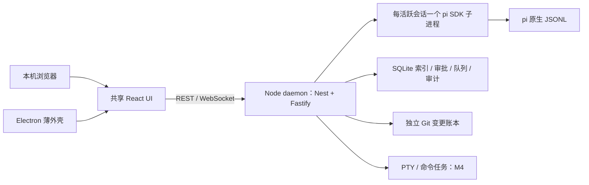

# Pi Workbench 实施方案

FILE-03 当前编辑／精确字节／原生锁／冲突覆盖及草稿生命周期规则见 [运行规则与验收](../validation/file-03-evidence/acceptance.md)。实现状态以 backlog 为准；此引用不表示已验收。

日期：2026-11-01（Asia/Shanghai）。状态：方案已确定，OPS-01 工程 / 离线 UI 基线已验收。关联 M1–M7；全量范围、依赖及进度仍以 `docs/product/backlog.json` 为准。

共同确认进展：用户已确认 Windows 桌面优先、保留本机网页入口、首个重点交付目标为 M3；服务采用 NestJS + Fastify，存储为 Drizzle + better-sqlite3 / pi JSONL，前端采用 React 组合，仓库采用 pnpm workspace。UI 已确认 Codex 式克制、中等密度、按需面板、跟随系统且明暗同等设计；屏幕“1080 100%”暂按 1920×1080 @100% 制稿。高保真已确认 A 日常对话 + B 展开审查组合，界面 / 消息 / 辅助字号为 14 / 15 / 12 px；[核心页面](../design/review.html)与[状态规格](../design/core-spec.md)继续细化。Node 24 仍为工程兼容基线，OPS-01 已固定并验证精确运行时与依赖版本。R9 已确认核心稿作为 M1 / M2 实现基线，先个人本地使用。记录见 [共同确认清单](../decisions/project-confirmation.md)，目录与边界见 [项目结构设计](project-structure.md)。

## 路线决定

独立实现 Pi Workbench，复用已经验证的 pi 1.4.0 SDK；采用 React Web UI、独立 Node daemon 和 Electron 薄外壳。PI-Desktop 用作规格、交互及测试参考，不直接 fork，也不整体移植它的 Rust 宿主或插件平台。

这符合当前目标：桌面与本机浏览器从第一版共用一个服务；保留 pi 原生历史；支持首次发送建会话、无项目会话、独立变更账本和后续 PTY。PI-Desktop 的现有桌面实现很有价值，但要适配这些规则，需要同时改动其宿主、持久化和客户端通路。独立路线避免在首版承担 Rust / TS 双工具链及上游架构迁移，代价是基础工作台需要自行实现与验收。

若目标只是立即使用现成桌面客户端，直接使用 PI-Desktop 有优势。本项目已经明确要建设双端、可追踪进度的自身产品，因此选择独立路线。后续若引用其源码，应单独记录固定提交、归属和 LGPL-3.0 要求；本次仅研究，没有复制产品源码。

## 技术栈与运行边界

| 层 | 确定采用 | 约束与验证时点 |
| --- | --- | --- |
| 工程 | TypeScript strict、pnpm workspace、ESM | TS 6.0.3；pnpm 12.16.1。精确锁文件与干净目录 frozen install 已验证 |
| 代码规范 | Oxlint + Oxfmt + Knip | 用户指定替换原 ESLint 方案；类型感知、import / package / Tailwind 排序、编辑器及门禁见 [代码规范](../development/tooling.md) |
| 运行时 | Node 24 LTS | 项目运行时固定并实测 24.22.2；pnpm 下载 / 选择该版本，系统 Node 26.13.0 不替换 |
| 前端 | React 19、Vite 8、Tailwind 4、shadcn/ui 基础组件 | 共享同一 SPA；不使用 Next.js / SSR；流式状态由自己的领域契约控制 |
| 状态 | 纯事件 reducer、Zustand 5、TanStack Query 5 | reducer 是运行状态唯一投影；Query 管列表 / 设置等请求缓存，不能另存一份可写运行状态 |
| 服务 | NestJS 12 + Fastify 5 适配器、REST + WebSocket、Zod 4 | Nest 模块管理服务 / 生命周期；daemon 为业务权威；契约与核心算法不依赖 Nest，双端不各自编排 agent |
| Agent | `@earendil-works/pi-coding-agent@1.4.0` 及配套 pi 包 | 每活跃会话一个 SDK 子进程；升级先重跑离线契约，付费证据需有单独预算 |
| 存储 | Drizzle + SQLite（better-sqlite3 13）+ pi JSONL + inflight 检查点 | Drizzle schema / 显式迁移由 daemon 管理；SQLite 单写入方，JSONL 由 SDK 写；原生模块按独立 Node ABI 构建 |
| 变更 | 独立 shadow Git 账本 | 延续 CORE-03 的原始字节、归属观察链、冲突预检和条件补偿，不操作用户 index / HEAD |
| 桌面 | Electron 45 薄壳、electron-builder 26 | main 只管窗口、系统集成、监护与更新；Renderer 无 Node 权限，preload 白名单 |
| 终端 | node-pty + xterm.js，M4 接入 | 留在 daemon；与 Electron ABI 分离；不因参考项目移除了 PTY 而删减需求 |
| 验证 | Vitest、Playwright、真实文件 / Git / SQLite、假内核 | 日常测试零付费；真实 Chromium / Electron 输入与恢复测试随阶段接入 |

2026-11-01 实际查询 npm 与 Node 发布元数据：Node 24.22.2 LTS、React 19.3.1、Vite 8.3.5、plugin-react 6.1.2、Electron 45.2.1、Fastify 5.12.7、better-sqlite3 13.0.3、Zod 4.6.7、Tailwind 4.3.3、Zustand 5.0.16、Query 5.105.0、pnpm 12.16.1。OPS-01 已完成精确锁定、干净安装、类型检查、构建、SQLite 原生迁移与 SDK 子进程冒烟；证据见 docs/validation/ops-01-acceptance.md。TypeScript 原方案 5.9.3 因 Vitest ESLint 插件要求 >=6 调整为 6.0.3。Electron 实际启动已验证，安装包 / 发布尚未实现。

Node 24 是成熟的受支持 LTS，当前 Node 26 也已进入 LTS；选择 24 是兼容与原生模块分发的工程基线，不表示 pi 或 NestJS 只能运行在 24，也不要求降级用户系统 Node。

OPS-01 已验证 Nest 启动 / 关闭、Fastify 只读 HTTP 与 Host / Origin 边界、Zod 契约、Drizzle 显式迁移、Node SQLite 原生模块、SDK 子进程和 Electron 开发壳。WS 鉴权 / 重放、真实会话权限、进程监护和 Electron 打包仍按 CORE-04 / 05、UX-05 与 OPS 后续条目验收。

桌面安装包携带独立 Node 24，`piw serve` 也使用相同服务入口；开发允许显式指定同一版本的 Node。普通用户无需安装系统 Node。不采用 `ELECTRON_RUN_AS_NODE`，避免 PTY / SQLite 的 Node 与 Electron ABI 分叉。M2 做桌面启动冒烟，M4 验证 PTY，M5 验证完整安装 / 升级 / 退出，发布体积以实际产物为准。

M0–M7 仅回环监听。同源 Web 资源由 daemon 提供；浏览器一次性配对、HttpOnly Cookie、Origin / Host 校验及 WebSocket 鉴权不能留到远程阶段再补。桌面连接同一 daemon，不新增另一套执行和审批 API。

## PI-Desktop spec 的采纳范围

| 规格领域 | 采纳到本项目 | 阶段与功能 ID |
| --- | --- | --- |
| 产品与架构 | UI / 特权服务 / agent 分离；有版本的边界契约 | M1 OPS-01、CORE-04 / 05；保留 Node 宿主和双端 |
| 协议与状态机 | 稳定消息 / 工具 / 轮次 ID；首个终态决定生效；旧轮次事件不结束新轮次 | M1 CORE-05、OPS-08；产品轮次仍按 D04 settled + snapshot |
| 存储与恢复 | 单写入方、启动栅栏、有界分页、流式检查点 | M1 CORE-06；复用 pi JSONL，不另造 Desktop 正文格式 |
| 会话与工作面板 | 每会话草稿、阅读锚点、工具展开和面板上下文；后台事件不抢焦点 | M2 SESSION-02、OBS-04；M4 UX-01 |
| 命名与搜索 | 本地标题回退、来源 / 版本 CAS；统一搜索入口可发现命令 | M2 SESSION-10 / 11 / 12；完整命令目录 M4 UX-02 |
| 工具与权限 | 最终参数裁决、取消唤醒等待、授权撤销、不可达不放行 | M2 SEC-01–04 / 09；执行入口延续 CORE-02 |
| 输入与附件 | IME、精确草稿恢复、长粘贴引用与内容分页 | M2 INPUT-01；M4 INPUT-03；附件暂存不提前创建会话 |
| 模型与上下文 | pi 模型目录优先；用户配置显式继承；截断标记、原结果保留和按需读取 | M4 MODEL、EXT、OBS；不复制自建上下文引擎或额外提供商 SDK |
| 安全 | Renderer 隔离、链接白名单、敏感字段脱敏、进程失败关闭 | M2 SEC-06 / 08、UX-05；真正 OS 沙箱 M5 SEC-05 单独验收 |
| 插件 | 清单、能力快照、启停、权限变化与兼容矩阵 | M4 基础适配，M6 EXT；不引入 `.piplug` 市场、签名平台或任意插件 UI 作为首版前提 |
| 交付与测试 | ADR / 规格 / 实现关联；离线 fixture；真实 UI 组合输入 / 导航 / 崩溃场景 | M1 OPS-08，M2 输入与双端，M5 发布 / 升级 |
| Worktree、多 Agent、自动化 | 真正并行写入隔离、任务身份、级联取消和预算 | M6 GIT，M7 MULTI / AUTO；不提前塞入 M2 |
| 远程、语音、图像、配置同步 | 保留候选，不作为本地版阻塞项 | M8 REMOTE / EXTRA，单独决定成本与授权 |

明确保留的差异：D15 首次发送才持久建会话；移除项目保留会话及文件；D07 独立账本保护用户已有脏改动；分叉不隐式恢复文件；PTY 仍交付；“计划”不能仅靠提示词限制写工具，也不复制参考产品 Plan + Auto 下允许 Bash 修改文件的语义。讨论 / 计划 / 执行的工具矩阵按 INPUT / SEC 条目细化，宿主策略才是执行边界。

## 关键实现规则

1. **单一正文来源。** SDK JSONL 保存已提交的真实历史。SQLite 维护索引、元数据、待送达请求、审批、队列和账本引用。搜索索引是可重建派生数据，以原消息 ID 回源；不得将搜索片段或 UI 截断结果写回历史或模型上下文。跨端创建请求持久去重，恢复不根据正文相等猜测是否已发送。
2. **流式恢复。** daemon 每 1.5 秒以内的目标间隔原子替换独立 inflight 文件，并在最终事件到达时刷新。用 sessionId / turnId / messageId / runtimeEpoch / seq 绑定，旧写入不得复活已完成消息。恢复仅展示“已中断的部分回复”，最终 SDK 消息存在时去重取代；不伪造 SDK JSONL 记录，不自动重放工具。间隔是初始策略，磁盘故障和硬杀损失范围必须实测。
3. **有界展示。** 初始历史每页最多 100 条，单条展示载荷初始 64 KiB；超限给出展开 / 分页入口，原文完整保留。UI 按 sessionId 保存滚动消息锚点与偏移、草稿及工具展开；最多保留 3 个会话视图，其余卸载后从锚点恢复。视图缓存与 SDK 进程池分别管理。
4. **增量不丢字。** 一帧内累计所有 `text_delta`，可合并渲染；不得只保留最后一个 delta。审批、错误、取消和最终消息立即冲刷。序号缺口则重新同步，最终消息覆盖临时投影并去重，不能继续盲目追加。
5. **工作面板归会话。** 文件、Diff、计划及产物均带会话 / 工作区身份。后台任务更新其会话标识，不自动打开面板或切换正在阅读的文件。终端归实际工作区；附加输出需用户明确操作。
6. **本地审批无倒计时。** 交互式本地工具审批持续等待允许 / 拒绝 / 取消。换会话、关闭审批展示、短暂断线不裁决，也不执行；turn 取消、内核 / 服务退出、参数或策略代际失效立即拒绝旧请求并唤醒等待。首个有效决定生效；待审批占用的资源可见且可取消，不被 LRU 回收。执行超时、连接健康检查和将来的无人值守审批是独立规则，无人值守缺少预授权时拒绝。本决定取代 Q05 原“10 分钟自动拒绝”候选。
7. **零额外命名调用。** 默认只按首条消息生成本地脱敏标题，最多 40 个 Unicode 字符。可选模型润色默认关闭，显式启用后使用已有提供商 / 模型、单次请求、10 秒超时、无工具；人工标题通过来源和版本保护。此处 10 秒是可选命名期限，不是审批期限。
8. **资源与费用。** 初始活跃内核最多 3、同时模型任务默认 1、终端最多 6；超限 FIFO 排队，可取消，运行 / 审批内核不自动回收。日常开发离线；R6 已授权必要真实验收每里程碑最多新增 2 次底层请求、单次输出最多 512 token、失败不自动重试。不另加标题、摘要、评审 Agent；失败 / 中止 / 压缩 / 工具后续回合均计数，先持久预占。OPS-01 验证原子守卫与 SDK 输出限制，不能可靠约束的路径先用离线样本。价格未知显示未知，不承诺金额硬上限；产品正常使用的通用预算仍属 M7。[预算政策](../validation/live-validation-policy.md)与[记录](../validation/live-validation-budget.json)区分已验证的持久预占算法和仍禁用的真实传输；SDK 隐式路径与提供商输出约束开放前单独验证；旧 4 次独立保留，本次新增 0 次。
9. **输入暂存。** 新会话使用独立 draftId；长粘贴 / 附件存入草稿暂存区，首次发送成功才绑定 sessionId。长粘贴引用保留精确字节、预览及撤销；失败保留原草稿，清理先判引用与宽限期。引用本身不保证节省 token；是否发送全文须在上下文预览说明。
10. **信任边界。** 执行守卫与进程隔离分别验收。原生 pi 扩展是可执行本地代码，其直接 Node API 不受工具守卫完全约束；不将 Rust、utilityProcess 或插件权限声明等同于 OS 沙箱。未验证能力默认禁用；M5 给出实际平台能力矩阵。

R6 默认权限：仅经验证的受限只读自动执行，写文件与命令先审批；普通命令不因声明只读而放行。显式会话授权绑定工具 / 最终参数 / 路径 / 目录边界，L3 始终单次确认。权限配置的进一步变化按 SEC-03 / 04 验收。

R6 生命周期：Electron × 默认收到托盘，保持任务 / 审批；自启默认关闭。菜单退出应用先保存并取消待审批 / 排队，停止受管 SDK、命令 / PTY 和 daemon，确认停止才完成退出。退出失败显示未停止对象与恢复方式；不误停独立 serve 或其他 CLI。浏览器关闭只断开查看。重启恢复记录、草稿和中断状态，不自动重放队列、副作用或旧授权。UX-05 验收真实窗口 / 托盘 / 服务行为；当前设计稿只提供说明预览。

## UI 何时设计、何时开发

现在就确定 UI 基线，不等到 M4。沿用现有 PRD 的中性灰、系统中文字体、左侧项目 / 会话、中间对话、右侧按需面板、底部终端。侧栏 244 px 为初始值；窄窗折叠为抽屉，输入、停止和待审批始终可达。状态用文字和图标表达，焦点可见，减少动效；面板上下文与执行上下文分别标注。

| 时间 | 必须产出 | 验收归属 |
| --- | --- | --- |
| M1 / OPS-01 同步 | 设计 tokens、基础组件和 UI 壳；新会话 / 运行 / 审批 / 错误 / 断线 / 恢复的可评审状态，使用假数据 | 只记录设计与工程基线，不能提前验收 SESSION / OBS / SEC |
| M2 | 接真实服务的创建、流式、中止、审批、切换、改名、搜索，以及浏览器 + Electron 入口 | SESSION、INPUT-01、OBS、SEC、UX-05 的各项验收 |
| M3 | 真实变更列表、Diff、接受、回滚、冲突与恢复 | CHANGE 及相关 WS / SEC |
| M4 | 完整可恢复面板、命令搜索、文件引用、PTY、设置与用量 | UX-01 / 02、INPUT、EXEC、MODEL |
| M5–M7 | 分发 / 沙箱 / 平台硬化，再增 Git、扩展、多 Agent、自动化 | 保留既有里程碑及依赖 |

不另起一套视觉重设计。UI/UX Pro Max 两次“阅读位置 / Scroll Restoration”定向查询返回的是平滑锚点和水平溢出建议，不足以证明会话恢复策略；未采用这些结果作为会话方案依据。具体恢复规则来自 PI-Desktop 的 ADR / 源码与本产品流程，焦点、键盘和响应布局使用现有设计及通用可用性原则。

## 接下来按这个顺序实施

| 工作包 | 关联功能 | 可评审结果与门禁 |
| --- | --- | --- |
| 1. 工程与契约基线 | OPS-01 | pnpm workspace、Node 24 固定、shared Zod / reducer、web / daemon 入口、SQLite 冒烟；M1 基础 UI 壳与状态清单；干净目录安装 / 类型 / 构建通过 |
| 2. 会话子进程 | CORE-04 | 单 SDK 子进程 ready / prompt / abort / dispose、守卫握手、异常隔离；先 fake kernel，再真实 SDK 离线，无付费请求 |
| 3. 契约门禁 | OPS-08 | M1 基线已交付：14 份固定录制、重复 / 缺口 / 迟到终态 / IPC 断开 / 审批取消、实际 UI 故障回归；随各阶段继续补齐真实产品验收 |
| 4. 状态与恢复 | CORE-05 / 06 | CORE-05 已验收：真实 SDK 本地事件、REST 快照、WS 双客户端重放 / 重同步；CORE-06 已验收 pi JSONL 索引、inflight / 队列 / 审批恢复记录 |
| 5. 有界资源 | CORE-07 | 已验收 3 内核 / 1 模型任务、6 终端预算、FIFO / 取消、空闲回收和受管冷恢复；M1 技术阶段门复核见下方 |
| 6. 可日常试用的对话 | M2 现有功能 | 真实新会话到中止、审批、查找、改名及跨端同步；不以静态壳代替产品完成 |

工作包是功能的实施细分，不新增完成率分母，不承诺未经估算的日期。依据 canonical backlog 当前为 **20 / 133 已验收**（CORE-01–07、OPS-01、SEC-06 / 07 / 08、WS-01 / 02 / 06、MODEL-01、SESSION-01 / 02 / 03 / 11 / 12；M1 技术阶段门已复核，OPS-08 跨阶段进度单列），146 个全量功能 ID、M0–M8 范围及负责人保持不变。SESSION-01 的自动门禁与真实 Windows IME / Electron 原生操作已通过；SESSION-02 的 3 视图 / 阅读与草稿 / 后台恢复及旧历史只读发现已验收。OPS-08 的 M1 基线已交付、整体继续进行中；WS-02 最近整理和 WS-06 项目组织 / 默认目录 / 原生重启已独立验收，SESSION-12 的搜索 / 筛选 / 脱敏索引 / 定位已完成离线门禁与真实 Windows IME / 原生重启验收，三项 verified。Q01 / Q02 已有 M0 证据；选定默认值只表示方案决定，不表示产品实现通过。

### CORE-04 已交付边界

daemon 的 `KernelService` 是唯一会话进程注册表，同时请求同一会话复用同一代际；cwd 经 realpath 固定，显式销毁后才可重建新 epoch。`SessionKernel` 管理启动 / ready / prompt / stopping / stopped / dispose，Zod 校验 IPC 版本、sessionId、turnId、epoch 与进程序号；核对实际 PID / cwd / SDK cwd / sessionFile。启动守卫不匹配、非法或旧轮次消息、IPC 丢失及进程崩溃均使该代际失效，不自动重启或重发。销毁等待实际进程退出；中止 / 销毁无响应时有界强杀，daemon 退出等待所有子进程，宿主硬退出后 SDK 子进程也清理正在运行的流。

当前执行能力固定为 **deny-all**：工具 / MCP / 扩展 / 技能均禁用，SDK 创建后及每轮前检查可执行工具为空。模型运行时使用独立空认证与本机 SSE 夹具，传输只允许该夹具 URL，禁止重定向与自动重试；不读取现有 pi 认证或改变配置。`real-sdk/local-fixture` 表示真实 SDK 配合本地模拟模型；`synthetic-ipc-fixture` 仅用于握手 / 断线 / 乱序 / 超时等故障注入。允许受限读取、生产审批的最终参数包装和真实模型预算守卫仍按后续 SEC / MODEL 功能验收。

浏览器与 Electron 继续连接同一 daemon；`GET /api/kernels` 仅只读诊断，两个观察者读取同一注册表，断开查看不销毁进程。UI 仍为 fake kernel 样本，没有 prompt / 审批写 API。这里的本地运行态与 SDK JSONL 不等于 CORE-05 的客户端重放或 CORE-06 的索引 / inflight 恢复；资源配额与受管冷恢复现已由 CORE-07 补齐，见下方边界。

验证：本轮新增 24 项 adapter / daemon 测试，完整 Vitest 36 项和浏览器 / Electron E2E 6 项通过；真实 SDK 本地流式、错误、未知工具拒绝、中止、运行中销毁、真实子进程硬杀隔离与宿主丢失清理均实际运行。`pnpm fix`、`pnpm run ci`、`pnpm verify:clean` 退出 0，干净目录 frozen 安装 / 构建 / 测试 / 冒烟 / 启停与锁文件 SHA-256 一致，新增真实提供商请求为 0。实现与可复验场景见 `packages/agent-adapter/src/kernel*.ts`、`sdk-child.ts`、`sdk-runtime.ts` 和 `apps/daemon/test/kernels.test.ts`；原始结果保留于 [CI 输出](../validation/core-04-evidence/ci.log)、[干净目录结果](../validation/core-04-evidence/clean-workspace.json)、[干净目录命令输出](../validation/core-04-evidence/clean-commands.json)。历史 M0 / OPS-01 证据不改写。

### OPS-08 已交付边界与后续绑定

M1 契约基线通过。测试只读重放 14 份 CORE-01 / 02 历史录制，固定原始字节 SHA-256、来源、事件与可见结果；包含原提供商的正常 / 压缩 / 中止证据，不重新调用。桥接事件及缺口注入为合成输入，不冒充生产 CORE-05 协议。共享纯投影已修正跨会话 / 代际误选、开始事件掩盖缺口及迟到事件改写终态；完整快照通过 Zod 验证后恢复，当前握手身份与请求版本仍由后续传输实现负责。

既有 SDK 子进程用例增加协议版本、重复 / 缺号、错误轮次 / 结果与旧终态注入；网页使用真实组件回归重复 / 超长 Unicode、缺口暂停与显式恢复、迟到响应、格式不兼容、未知命令文本和渲染异常。异常时保留草稿，使用既有 shadcn Alert / Button；仅离线展示恢复，不自动执行 / 重试 SDK。渲染故障场景故意抛出的 React 日志保留，错误边界和键盘返回实际验证。

`pnpm test:contracts` 提供定向入口；完整 test / CI 已包含同一批测试。OPS-08 首次基线的完整 CI 为 **85 项 Vitest + 12 项浏览器 / Electron E2E**，`pnpm fix`、`pnpm run ci`、`pnpm verify:clean` 退出 0，干净目录安装 / 构建 / 启停通过且锁文件一致，新增真实提供商请求 0。验收范围、逐阶段矩阵与截图见[工具规范](../development/tooling.md#ops-08-契约回归门禁)；原始 [CI](../validation/ops-08-evidence/ci.log)、[干净目录结果](../validation/ops-08-evidence/clean-workspace.json)与[命令输出](../validation/ops-08-evidence/clean-commands.json)独立归档。

OPS-08 第一条验收通过，第二条仍未通过，整体保持 `in_progress`。CORE-05–07 及 M2 已验收功能均绑定同一门禁；SESSION-01 已补真实 Windows IME、首发 / 续发、草稿 / 设置返回与目录 / 主题。SESSION-02 已补齐视图 / 后台任务恢复与旧历史只读发现；其余改名、生产业务审批 / 双端交互、M3 回滚及后续平台验收随产品实现纳入。程序合成事件、离线样本与真实系统输入法来源分别记录，不将 OPS-08 整体提前记为已验收。

### CORE-05 已交付边界

daemon 的 `EventService` 保存每会话的完整内存观察快照和有界重放日志，`KernelService.prompt / abort` 是当前内部应用入口，按同一 SDK 运行时发布开始、全部文本增量、工具观察及终态。工具由 SDK 的 `tool_execution_start / end` 映射，未知工具的拒绝有真实 SDK + 本地模型夹具证据；工具执行仍禁用。审批帧的投影与即时发送已用合成观察测试，生产审批服务仍属 M2。所有下行帧立即发送，不用节流丢弃最后一个 delta；`completed` 表示当前 deny-all SDK 生命周期结束，不代表 M3 变更快照或审查完成。

| 接口 | 当前行为 |
| --- | --- |
| `GET /api/protocol` | `hello` 返回独立的协议版本与实际能力列表、daemonId；明确 `mutations: false`、真实提供商关闭 |
| `GET /api/sessions/:sessionId/snapshot` | 完整内存快照及同一边界的 seq；未知运行时 404，`Cache-Control: no-store`，不读写截断历史 |
| `WS /api/events` | 先 hello，再接收且仅接收一条带版本 / 必需能力 / daemonId / sessionId / epoch / since 的 subscribe；重放后发 caught-up 并持续推送 |
| `http://127.0.0.1:5173/?observe=<sessionId>` | 实际 React 只读观察页，复用 shadcn Alert / Button / Bubble；系统明暗、窄窗与键盘断开 / 重连；普通入口继续保留离线工作台 |

身份与顺序细化原架构草案的全局 seq：**daemonId** 每个服务实例唯一，**epoch** 每个内核代际唯一，**seq 在每个 sessionId + epoch 内连续递增**，事件 ID 固定为 `epoch:seq`。这样订阅单会话不会把其他会话的事件误判为缺口。turnId 不复用，当前聚合回复 messageId 为 `turnId:assistant`，工具以所属轮次内的 SDK toolCallId 去重，更新保留首次出现顺序。跨身份 / 旧代际回调被拒绝，重复与迟到终态不覆盖当前轮次。

快照捕获与游标在同一同步边界，重放到实时监听的交接不经过 await。默认重放保留最近 **1024 条 / 2 MiB**，任一超限淘汰最旧记录；仅日志淘汰，不截断完整快照或写回 SDK JSONL。游标过旧 / 超前、代际或服务不匹配均返回 `resync-required`。客户端遇到序号缺口停止增量拼接，校验并替换完整快照，再从新游标订阅；请求代际与 AbortController 拦住迟到快照，服务 / 内核重建不混入旧内容。

连接关闭只停止观察，任务继续；自动重连按 1 / 2 / 4 秒递增到最多 30 秒，只发送游标，不重发 prompt、审批或工具。HTTP 等待最多 5 秒；WS 在 10 秒内要求 subscribe，15 秒 ping / 下一周期无 pong 终止；入站订阅帧上限 16 KiB，出站积压超过 2 MiB 断开慢观察者。继承已有 Host / Origin 校验，WS 还拒绝缺失 Origin；SEC-08 现已在该通道叠加配对与 Cookie 身份；生产写权限仍按后续 SEC 功能验收。不兼容时保留内容，提示匹配版本 / 重启后再同步，变更入口保持禁用。

验证：新增 5 项共享契约、4 项服务 / 原生 TCP WebSocket 测试、4 项浏览器实际组件测试；完整 **94 项 Vitest / 16 项浏览器与 Electron E2E** 通过。两条 TCP 观察连接和两个浏览器客户端验证真实 SDK 本地流式、中止、未知工具拒绝、错误与补发；缓冲 / 丢帧 / 迟到快照 / 代际替换 / 版本能力异常为明确标注的合成观察或网络故障。浏览器测试仅将 REST 代理和原生 WS URL 指到隔离 daemon，不替换客户端 reducer 或制造正常 SDK 帧。`pnpm fix`、`pnpm run ci`、`pnpm verify:clean` 退出 0；全新目录安装 / 检查 / 构建 / 测试 / SDK 冒烟 / 启停通过，锁文件 SHA-256 一致，新增真实提供商请求 0，预算账本与历史证据未改。

实现位于 `packages/shared/src/runtime-contracts.ts`、`apps/daemon/src/modules/events`、`modules/kernels/kernel.service.ts`、`apps/web/src/services/runtime-client.ts` 与 `features/conversation/runtime-observer.tsx`；定向入口已并入 `pnpm test:contracts`。原始 [CI](../validation/core-05-evidence/ci.log)、[干净目录结果](../validation/core-05-evidence/clean-workspace.json)、[命令输出](../validation/core-05-evidence/clean-commands.json)及 [双端输出](../validation/core-05-evidence/runtime-two-clients.png)、[深色窄窗](../validation/core-05-evidence/runtime-dark-390.png)、[重同步](../validation/core-05-evidence/runtime-resync.png)、[不兼容提示](../validation/core-05-evidence/runtime-incompatible.png)独立归档。CORE-05 两条验收通过；内存快照不等于 CORE-06 的持久化 / inflight 崩溃恢复，资源配额留待 CORE-07，真实发送 / 审批、历史分页和正式会话 UI 随后续功能验收。

### CORE-06 已交付边界

SessionStore 是 daemon 唯一持久索引与恢复记录服务。显式 Drizzle 迁移新增 sessions、session_runtimes、session_turns、session_queue、session_approvals、session_changes；SQLite 使用 WAL、synchronous FULL 与外键。数据根的 PID / token 租约拒绝同一目录的第二个活跃 daemon，死进程租约可替换，损坏 / 无法确认的租约保留并拒绝启动。退出由 KernelService 等待 SDK 终态及实际进程退出，然后关闭事件观察、冲刷检查点、关闭 SQLite 与释放租约，避免 Nest 并发销毁使终态丢失。

正文仍只由 SDK 写入原生 v3 JSONL。每轮 prompt 前通过 SDK SessionManager.appendCustomEntry 写入 pi-workbench.turn.v1 元数据，绑定 sessionId / epoch / turnId / messageId；它不参与模型上下文。读取器不调用会迁移 / 重写的 SessionManager.open，按原生 id / parentId 读取当前分支，识别系统元数据，校验 UTF-8、版本与身份。损坏 / 重复 / 缺父记录、未完整末行、缺失源和索引 / 检查点损坏均保留原件并报告，受损会话阻止新任务；其他会话可继续读取。诊断可按记录导出；当前出口已由下方 SEC-06 统一过滤，无敏感内容保留原字节，有敏感内容导出脱敏副本，无法安全解析时拒绝导出。缺失文件没有可导出的字节。完整正文与展示截断结果不写回 JSONL / 模型上下文。

| 入口 | 当前行为 |
| --- | --- |
| GET /api/sessions | 读取受管会话索引；不创建 / 接管旧 CLI 会话，不启动内核 |
| GET /api/sessions/:sessionId/history | 默认最新 100 条 / 页；单条文本预览最多 64 KiB UTF-8，稳定消息 ID 锚定更早页面；失效游标明确要求刷新 |
| GET /api/sessions/:sessionId/messages/:messageId/content | 显式读取完整原文，返回安全 text/plain；不接受客户端文件路径 |
| GET /api/sessions/:sessionId/diagnostics/:diagnosticId/raw | 下载单条损坏记录的精确二进制原件，不编码转换或自动修复 |
| http://127.0.0.1:5173/?history=<sessionId> | 实际 React 只读历史页，复用 shadcn MessageScroller / Message / Bubble、Alert、Badge、Button；分页、全文展开、键盘刷新与带错误反馈的二进制下载 |

独立检查点路径为数据根 inflight/<sessionId>/<epoch>-<turnId>.json，仅包含当前未落入 SDK 的观察投影；开始在任务发送前持久化，文本以 **1.5 秒目标间隔** 合并，工具 / 审批 / 停止 / 最终事件立即冲刷。写临时文件、fsync 后 rename 原子替换，不先删除旧文件；真实文件系统写入失败时保留旧检查点、提供诊断并阻止新任务。目标间隔受到事件循环和磁盘影响，不是硬实时或断电损失保证。

恢复按 sessionId / epoch / turnId / messageId / seq 校验，迟到旧 seq 不覆盖新检查点。SDK 终态原文存在时替代旧部分回复；不存在时仅展示“已中断的部分回复”，未确认送达的输入单独标记，均不伪造 SDK 记录。CORE-05 恢复最新轮次观察、换用新 daemonId 并将 seq 归零，旧游标重新同步；更早正文走分页读取。重启不创建 SDK 进程、不自动重发队列 / 工具或恢复旧授权：queued 变 held，pending 审批变 invalidated，已有 allowed / denied 只保留审计且 executable=false，变更引用仅只读保存。

边界：当前是受管本地 SDK 历史与恢复底座，普通工作台仍使用离线样本，没有真实发送 / 续聊 / 审批写 API。队列、审批和变更引用用明确标注 synthetic-fixture 的持久记录验证，不代表其 M2 / M3 业务服务或可回滚快照已实现。SDK 在新代际显式创建的会话不会自动把展示历史当成模型上下文；受管原生上下文冷恢复现已由 CORE-07 补齐；旧 CLI 历史接管 / 续聊仍属 SESSION-06。现有 CLI 历史发现属 M2，数据目录迁移 / 备份和数据库页损坏恢复属 OPS-04 / 05。分页限制响应与展示载荷；当前仍扫描 JSONL 校验分支，不承诺超大历史 IO 或性能指标。

验收：新增 **12 项 Vitest + 3 项浏览器流程**，完整 **106 项单元 / 集成、19 项浏览器与 Electron E2E**、SDK 冒烟通过；pnpm fix、pnpm run ci、pnpm verify:clean 退出 0。真实 SDK + 本地 HTTP 模型夹具实际完成正常 / 中止 / 错误、相同正文不同轮次，以及 SDK / daemon 同 tick SIGKILL 后的持久恢复；正常读历史和恢复均不修改 SDK 原件。分支 / 未来版本 / 损坏 / 分页 / 长 Unicode、旧检查点身份 / seq / 终态去重及工作台记录是明确标注的合成样本；检查点写失败使用真实文件系统阻断。浏览器用实际组件与隔离 daemon 验证分页、全文、部分回复、诊断原始下载、明暗 / 390px 与键盘刷新，不替换存储或生成正常 SDK 帧。全新目录 frozen 安装、检查、构建、106 项测试、冒烟和服务启停通过，锁文件 SHA-256 一致，真实提供商新增请求 0，真实预算与历史证据未改。

实现为 packages/shared/src/history-contracts.ts、packages/agent-adapter/src/native-history.ts / sdk-child.ts、apps/daemon/src/modules/sessions 及数据库迁移、events / kernels / bootstrap 接线、apps/web/src/features/conversation/session-history.tsx；原生读取、存储和真实硬杀已加入 pnpm test:contracts。原始 [CI](../validation/core-06-evidence/ci.log)、[干净目录结果](../validation/core-06-evidence/clean-workspace.json)、[命令输出](../validation/core-06-evidence/clean-commands.json)，以及复核的 [原生历史](../validation/core-06-evidence/history-native.png)、[深色窄窗](../validation/core-06-evidence/history-dark-390.png)、[中断恢复](../validation/core-06-evidence/history-interrupted.png)、[诊断与导出](../validation/core-06-evidence/history-diagnostic.png)独立保留。CORE-06 两条验收通过；CORE-07、SEC-06 和 M1 技术阶段门复核见下方。

### CORE-07 已交付边界

daemon 的 KernelPool 统一分配内核名额，KernelService 统一分配模型任务名额。默认 **3 个活跃内核、1 个模型任务、6 个终端预算**；启动中和回收中的进程仍占内核名额，确认实际退出后才释放。内核与模型各自 FIFO，队列位置分别计数；复用已有内核不消耗新名额，不会被其他会话的新建请求阻塞。每种等待队列最多 256 个请求，超限明确拒绝，不创建进程或发送输入。一个会话同时仅接受一个受管任务；M2 的 steer / follow-up 是后续独立业务队列。

排队任务可以按会话 / turnId 取消，内核等待也接受 AbortSignal。取消一个共享启动的等待者不会取消另一个调用者；已取消输入不进入 SDK。运行中的取消必须等 SDK 终态才释放模型名额，进程异常等待实际回收；本地错误不自动重试。退出先拒绝等待、停止并回收所有子进程、等待任务收尾，最后关闭事件、持久化和数据库。资源等待只存在本次 daemon 内存中，不冒充 M2 已持久接受的用户消息；重启不会重发。

压力下优先回收最近最少使用的空闲内核；默认空闲 **300 秒**后自动回收，运行中、已被任务预留和待审批内核不回收。审批观察变化立即唤醒队列，不等待定时扫描。受管历史不随回收删除；下一次显式打开使用新 epoch / PID 和原生会话身份，先校验来源、路径、cwd、v3 版本与历史完整性，再由 SDK 打开原文件恢复上下文，不复制整份历史，也不把 inflight 部分回复导入模型。多代际共享同一文件时，消息身份保持稳定且只展示一次；旧中断检查点仍留在原轮次位置。损坏 / 不支持来源阻止冷恢复，保留原件并释放未用名额。旧 CLI 会话接管仍属 SESSION-06。

| 入口 / 配置 | 当前行为 |
| --- | --- |
| GET /api/kernels/resources | Zod 校验的只读占用、限额、队列原因 / 顺序及内核状态；no-store，沿用 Host / Origin 校验 |
| http://127.0.0.1:5173/?resources | 实际 React 资源观察页，复用 shadcn Alert / Badge / Button；每秒读取，失败保留上次结果并明确失去同步，支持键盘刷新与系统明暗 |
| PIW_MAX_KERNELS / PIW_MAX_MODEL_TASKS | 启动时配置，范围分别 1–32 / 1–16，默认 3 / 1 |
| PIW_MAX_TERMINALS / PIW_KERNEL_IDLE_MS | 终端预算范围 1–64，默认 6；空闲时间范围 1–86400000 ms，默认 300000；无效配置在打开数据库前拒绝 |

模型占用包含已获得名额、正在等待内核的任务；启动和回收状态可见。网页仍只读，取消通过已验证的内部任务入口，SEC-08 配对见下方，客户端发送 / 取消业务接口继续按 M2 验收。终端仅预留预算，真实 PTY 在 M4 验收；浏览器会话视图缓存与进程池分别管理，不能据此宣称视图保留策略已实现。配置上限只是初始策略，不是内存 / CPU 性能保证。

验收新增 **12 项服务集成 + 2 项浏览器流程**。真实 SDK + 本地 HTTP 夹具验证 3 内核启动计数、模型限额 / FIFO、等待取消、共享启动取消、256 请求背压、错误与 SIGKILL 后名额释放、真实流式不中途回收、自动空闲回收、原生上下文冷恢复、损坏文件拒绝和关闭清理。待审批保留使用明确标注的合成观察，M2 生产审批尚未实现；中断检查点归位 / 不注入上下文也使用明确标注的合成检查点，正常前后轮次经真实 SDK。排序回归已先在旧逻辑复现失败、再修复通过。浏览器只代理到隔离 daemon；503 / 不兼容为 HTTP 故障注入，实际组件验证队列、取消后的顺序、离开页面不停止任务、1080p / 深色 390px、键盘刷新与错误恢复。

完整 **118 项 Vitest / 21 项浏览器与 Electron E2E**、SDK 冒烟、pnpm fix、pnpm run ci 与 pnpm verify:clean 全部通过；新目录 frozen 安装 / 检查 / 构建 / 测试 / 启停与锁文件哈希一致。daemon 仅新增声明已有 catalog 中的 Zod 直接依赖，无新版本或第二套校验库。原始 [CI](../validation/core-07-evidence/ci.log)、[干净目录结果](../validation/core-07-evidence/clean-workspace.json)、[命令输出](../validation/core-07-evidence/clean-commands.json)、[FIFO 状态](../validation/core-07-evidence/resources-fifo.png)、[深色窄窗](../validation/core-07-evidence/resources-dark-390.png)和[失去同步](../validation/core-07-evidence/resources-unavailable.png)独立保留。新增真实提供商请求 0，原预算和历史证据未改；未归档重复截图、测试目录和运行数据不入库。

M1 的三个技术阶段门分别由 CORE-05 的双端顺序 / 重放、CORE-06 的硬杀 / 中断恢复及本次 CI 中的协议 / SQLite 迁移 / 假内核契约复核，运行底座具备进入 M2 的条件。OPS-08 是跨阶段功能，整体继续 in_progress，不将其后续真实交互、回滚和平台门禁提前验收，因此 M1 条目统计仍非全数 verified。M2 的 SEC-06 / 07 / 08、WS-01、MODEL-01 与 SESSION-01 / 02 已在下方逐项验收，整体 M2 阶段门仍待其余功能。

### SEC-06 已交付边界

SecurityService 沿用现有 pi 的 auth.json / models.json，不建立第二套凭证库，不复制配置密钥到 SQLite、renderer 或 SDK IPC。默认离线开发不读取真实凭证；显式 PIW_PI_AGENT_DIR 指定现有配置目录后，宿主只返回提供商 ID、来源、认证种类及缺失 / 已配置但未联网验证 / 过期 / 命令未执行 / 无效状态。静态值解析遵循已安装 pi 1.4.0 的 $ENV / ${ENV}、$$ 与 $! 规则，仅读取明确引用的环境变量；不运行 ! 命令、不刷新 OAuth、不联网校验，也不改选现有模型。模型发现及真实传输仍由 MODEL-01 等条目验收。

宿主内部 saveApiKey 只更新明确指定的原生 API key，保留其他提供商、自定义字段及 models / settings；拒绝把 OAuth 隐式改成 API key。通过 SHA-256 revision、兼容 pi 的 auth.json.lock 目录锁、锁内重读和提交前冲突检查保护并发，不抢已有锁、不覆盖损坏文件或符号链接。先把原文件 POSIX mode / Windows DACL 应用到空的兄弟临时文件，再写入并 fsync，最后原子替换；失败保住原配置并返回 save-failed / conflict / locked 等诊断。Windows ACL 命令使用固定脚本、最小环境和超时，无凭证参数或输出。原生 pi 文件的保存方式仍由 pi 所有，不宣称文件已加密或已接入 Electron safeStorage。浏览器凭证写请求为 403；配对已由 SEC-08 接入，配置修改 UI 留待 MODEL-02。

同一 shared Redactor 覆盖结构化敏感字段、*_KEY / *_TOKEN、Authorization / Cookie、Bearer / Basic、URL 认证、命令参数、常见 token / PEM 及宿主已读取的原生凭证值，包含 URI / JSON 转义形式；旋转后保留旧值注册以保护迟到输出。HTTP 统一出口、异常诊断、审批摘要、REST 快照、WS 实时 / 重放、历史预览 / 全文和损坏记录导出都走同一策略。响应 no-store / nosniff，关闭原始请求日志；未知服务异常只返回通用消息，宿主诊断也先脱敏。此内容过滤不能识别所有未知、编码或混淆的秘密；未来通知 / 搜索 / 扩展等新出口必须继续接入并验收。

执行参数、SDK JSONL 和独立检查点仍为原始权威内容，脱敏只发生在展示 / 输出边界，不改写模型上下文或审批执行快照。EventService 按累计原文处理流式分片，暂存可能构成密钥的未完整后缀，正常中文及无空格内容继续流式；中止 / 错误终态、崩溃恢复以及历史预览 / 全文仍保护未完整后缀，不在停止时将其重新放出。安全增量无法追加时使用 message.replaced，turn.finished 可带终态安全全文；新必需能力 redacted-observation 阻止旧服务被误当作安全通道。visibleSnapshot / visible subscription 与原始持久快照分开，原始及可见重放共同计入有界字节预算；重连不改事件身份或重发任务。

损坏记录导出先验证 UTF-8。没有命中敏感内容时保留原字节；有敏感内容时只生成脱敏副本，标记 x-piw-redacted: true，文件名为 piw-redacted-record.txt；无效 UTF-8 / 无法安全解析的二进制返回 422，原始文件保留。历史页按钮改为“导出记录（先脱敏）”，失败显示明确反馈。完整原件只留本机，不再通过浏览器出口绕过过滤。

实际 React 的 http://127.0.0.1:5173/?credentials 从顶部“凭证与隐私”进入，只显示元数据，无明文输入 / 回显 / reveal，不写浏览器持久存储。复用现有 shadcn Alert / Badge / Button，支持刷新、加载 / 空状态、失败保留旧值并标明过期、键盘、系统明暗和 1920×1080 / 390px；没有引入新的组件基础或依赖。

验收新增 **9 项 Vitest（3 项共享脱敏 + 6 项服务）及 2 项实际浏览器流程**。合成凭证验证缺失 / 过期 / 环境引用 / 命令拒绝、原子保存、锁 / 冲突、真实文件写失败和实际 Windows ACL 保留；真实 SDK + 本地 HTTP 夹具验证含敏感内容的原始历史保持、REST / 全文 / 导出过滤和二进制拒绝。合成审批与分片观察经实际原生 TCP WS、React 页面和重载验证，合成原生中止记录验证全文出口；密钥前缀在中止终态重新出现的问题已先复现失败、再修复通过。HTTP 503 是故障注入；不等于生产审批、配对或真实提供商验收。正常流式、硬杀恢复及既有 CORE-05–07 回归继续通过。

pnpm fix、完整 pnpm run ci 和 pnpm verify:clean 均退出 0；**127 项单元 / 集成、23 项浏览器与 Electron E2E**、SDK 本地冒烟及新目录 frozen 安装 / 构建 / 服务启停通过，锁文件 SHA-256 一致。新增真实提供商请求 **0**，真实预算账本和固定 SDK 录制未改。实现位于 packages/shared/src/redaction.ts / security-contracts.ts、apps/daemon/src/modules/security、bootstrap / events / sessions 出口及 apps/web/src/features/settings/credential-status.tsx；安全测试已纳入 pnpm test:contracts 和完整 CI。原始 [CI](../validation/sec-06-evidence/ci.log)、[干净目录结果](../validation/sec-06-evidence/clean-workspace.json)、[命令输出](../validation/sec-06-evidence/clean-commands.json)，以及目视复核的 [凭证状态明色](../validation/sec-06-evidence/credentials-light.png)、[深色 390px](../validation/sec-06-evidence/credentials-dark-390.png)、[脱敏审批摘要](../validation/sec-06-evidence/redacted-approval.png)独立归档，其余重复截图和临时工作区不入库。SEC-06 两条验收通过，OPS-08 整体仍进行中；SEC-08 的后续交付见下方客户端授权边界。

### SEC-08 本机客户端授权边界

宿主 AccessService 签发 256 bit 随机票据（64 位十六进制），120 秒有效，同步原子消费后即失效；HTTP 仅能兑换，不能生成票据。最多 4 个未消费票据、32 个有效客户端，每 daemon 每分钟最多允许 10 次失败兑换。票据和客户端 bearer 的查找表只存 SHA-256；SEC-06 内存脱敏注册表也登记原值以过滤意外输出，不落 SQLite、JSONL 或日志。客户端名称只作展示，不产生权限。

桌面由受管 launcher 的父子进程私有 IPC 获取 desktop 票据，main 经 HTTP 兑换并写入隔离 renderer 的 HttpOnly Cookie，无 renderer 特权桥。原生“工作台”及托盘菜单生成 browser 票据并只打开固定回环工作台链接。网页开发在拥有宿主的交互 TTY 输入 `pair`，显式显示一次性链接；非 TTY 不显示票据。独立 `pnpm start` 仅提供 API，TTY 只输出短期票据，不冒充已托管前端。票据通过 URL fragment 交给页面，加载时及同页 hashchange 后立即移除，仅留内存待明确提交，不写 localStorage / sessionStorage，不进入 query / referrer；有效票据仍是短期能力，链接不应分享。

每次配对生成独立 UUID 与 256 bit bearer。会话 Cookie 为 `piw_client_<port>`，`Path=/api; HttpOnly; SameSite=Strict`，无持久过期时间；当前 HTTP 回环入口不能冒充 HTTPS Secure Cookie。授权采用 8 小时绝对期限，不靠活动续期；关页不撤销，清 Cookie 后须重新配对，旧身份可由其他已配对客户端撤销。服务重启丢弃全部票据、客户端和 CSRF；即使 Cookie 仍在，也须全新配对，不从数据恢复或自动续权。

| 入口 | 访问与裁决 |
| --- | --- |
| `GET /api/health`、`/api/protocol`、`/api/access`、明确 `/api/lab/scenes/:scene` | 仅公开健康、协议、当前认证状态或 fake 样本；不返回其他客户端、会话正文、凭证或 bearer |
| `POST /api/access/pair` | 精确 Host / Origin、JSON 和单次有效票据；不能由请求指定 desktop 身份 |
| `GET /api/access/clients` | 有效 Cookie；仅返回 ID、名称、类型、创建 / 到期时间，无 bearer / 票据 / CSRF 列表 |
| `POST /api/access/clients/:id/revoke` | 有效 Cookie + 所属客户端 CSRF；可撤销浏览器，包括自身；桌面身份由宿主管理 |
| 会话 / 历史 / 全文 / 导出 / 内核 / 资源 / 凭证 REST、`WS /api/events` | 默认须认证；WS 还需显式允许的 Origin，撤销 / 到期立即关闭所属 socket（1008） |
| 其他现有及未来写入口 | 默认须认证、精确 Origin、JSON 和所属 CSRF；不能通过未知路径、代理头或方法绕过 |

Host 必须等于 `127.0.0.1:<daemonPort>`。允许同 daemon Origin，开发入口另允许精确 `http://127.0.0.1:5173`；`null`、localhost 别名、其他端口和外部 Origin 均拒绝，代理头不授予身份。Vite 只作固定目标代理，不能以放开 Host / Origin 修复联调。拒绝未认证升级发生在 WebSocket 插件标记 request.ws 前，因此出口显式释放原始 socket，避免 daemon 退出挂起。公开读取与配对也受 Host / Origin 规则约束。

`?clients` 提供身份列表、刷新、两步撤销和重配表单，实际数据入口共同经过 ClientAccess。身份改变时卸载旧视图并清除私有请求缓存；WS 授权失效停止重连并切回配对。撤销只停止观察，daemon 中的 SDK 任务继续；不恢复旧工具审批，也不授予执行权限。普通明确标注的离线样本保持公开。MODEL-02 凭证修改、生产审批和真实提供商传输仍未开放。

测试入口为 `apps/daemon/test/access.test.ts`、`e2e/access.spec.ts` 和 `e2e/desktop.spec.ts`；已有 CORE / SEC-06 测试先通过真实票据兑换建立独立夹具身份。服务集成覆盖单次 / 到期 / 并发兑换、限额、CSRF、错误 Host / Origin、默认拒绝、重启及原生 TCP WS；实际 SDK + 本地模型夹具验证撤销不断任务。过期时钟仅在独立授权服务中注入，真实 HTTP / WS 不用假响应。Electron 测试导入真实 main，通过真实父子 IPC / Cookie / 原生菜单运行；仅拦截操作系统外部浏览器启动，核对链接及一次性兑换，不自动打开用户浏览器。IME 为程序合成事件，仍不代表真实 Windows 输入法人工验收。完整回归及证据以本条最终验收记录为准。

SEC-08 两条验收通过，新增 **7 项单元 / 服务测试与 3 项浏览器 / Electron 流程**。`pnpm fix`、完整 `pnpm run ci` 及 `pnpm verify:clean` 退出 0，**134 项 Vitest、26 项浏览器 / Electron E2E**、真实 SDK 本地冒烟、新目录 frozen 安装 / 构建 / 运行 / 退出均通过，原目录与新目录锁文件 SHA-256 一致；新增真实提供商请求 **0**，真实预算和固定录制未改。首次原生 WS 拒绝后退出挂起已复现，补早期拒绝 socket 清理后通过；同页打开新链接也有实际浏览器回归。SEC-08 TCP 测试使用 24348，与现有 4328 和本机低位动态端口分开，未停止无关程序。

独立保留 [CI 原始输出](../validation/sec-08-evidence/ci.log)、[干净目录结果](../validation/sec-08-evidence/clean-workspace.json)、[命令输出](../validation/sec-08-evidence/clean-commands.json)，以及目视复核后的 [1080p 客户端](../validation/sec-08-evidence/clients-light.png)、[390px 深色配对失败](../validation/sec-08-evidence/pairing-dark-390.png)、[实际 Electron 身份](../validation/sec-08-evidence/clients-desktop.png)。不归档依赖、运行库、临时驱动或重复截图。OPS-08 整体仍 `in_progress`；SEC-07 的后续交付见下方资源信任边界。

### SEC-07 已交付边界

TrustService 区分项目、显式用户目录及第三方声明，展示资源来源、影响、SHA-256 指纹、预览、信任与实际能力。项目目录由用户明确输入并按 realpath 规范化，不向上继承祖先指令；用户资源只在宿主明确设置 PIW_PI_AGENT_DIR 后发现，默认不读取真实 pi 配置。覆盖当前目录的 AGENTS / CLAUDE 指令、.pi 的 SYSTEM / APPEND 文本、扩展 / 技能 / 提示 / 主题 / scripts、settings 中的声明与 package.json scripts。第三方包仅展示来源声明，不解析、下载、安装或 import；未知设置不合并到宿主权限。

按用户确认，信任绑定实际目录、单项资源来源和内容指纹，存入 daemon 独占 SQLite 的 resource_trust 表，重启后复用完全匹配的版本。只保存元数据、确认客户端 / 时间及撤销时间，不复制正文。确认前服务端重新检查资源，旧预览不能批准新字节；写库失败、损坏记录、越界、链接 / Windows junction、硬链接、二进制上下文及不可完整检查来源均不获得加载许可。单文件最多 64 KiB；目录树最多 2 MiB / 512 项 / 8 层；一次发现最多 2048 项 / 8 MiB、256 资源；每轮文本最多 512 KiB / 128 项。记录最多 5000 条，不自动清理历史。

KernelService 在内核 / 模型排队结束后逐轮重新检查，将已确认的上下文文本快照通过私有 IPC 送给 SDK；SDK 不按外部路径重新读取。读取前后检查文件身份，实际已检查字节作为本轮不可变快照；每轮替换系统上下文，包括空快照。撤销从下一轮生效，不停止当前任务、不删除资源或改写原生历史；旧模型回复仍可能包含此前文本。冷恢复重新核验，不将历史信任当作执行审批。此策略不是同一系统用户下的 OS 沙箱，也不承诺防止其他进程任意篡改宿主。

SDK 使用显式、无资源 IO 的 ResourceLoader，避免 DefaultResourceLoader 在过滤扩展前先解析包来源。扩展、技能、提示模板、主题、脚本、安装动作及外部设置合并全部禁用，即使已保存对应信任；当前仅加载已确认的上下文文本。工具仍 deny-all，真实提供商仍关闭，外部文本不能增加工具、修改最终参数守卫或伪造信任记录。后续 EXT / EXEC 等条目接入执行资源时，须同时验证信任、实际能力和最终执行守卫；不以本次验收声称已支持扩展执行。

| 入口 | 当前行为 |
| --- | --- |
| 侧栏设置区“资源信任”、`http://127.0.0.1:5173/?trust` | 配对后检查明确目录、逐项预览 / 确认、查看记录及单项撤销；显示当前轮次使用的资源与下一轮生效说明 |
| `GET /api/trust` | 返回信任记录与当前活动轮次快照，无资源正文或执行接口 |
| `POST /api/trust/inspect`、`/grant`、`/revoke` | 受 SEC-08 身份、精确 Host / Origin、JSON 和客户端 CSRF 保护；严格 schema，确认绑定当前指纹 |

实际 React 页面复用已有官方 Field / Input / Alert / Badge / Button / Separator，无新 primitive 或第三方依赖。失败保留旧信息并禁用决定；预览绑定原版本，跨目录迟到响应不替换当前对象；每 5 秒刷新不改变已打开的确认内容。预览最多 12000 字符，明确指纹覆盖完整已检查内容；纯文本显示恶意 SVG。确认区键盘聚焦、取消返回触发按钮、结果聚焦状态，长列表可滚动。侧栏底部入口避免在窄窗挤占工作台顶部；明暗、1920×1080 / 390px 及真实 Electron 入口均已验证。

新增 **7 项服务集成测试与 2 项浏览器流程**，扩充既有真实 Electron 主进程测试。真实 SDK + 本地 HTTP 夹具逐轮检查系统提示中的未信任、已信任、变化、撤销和冷恢复；另验证 FIFO 等待后重查、活动快照、持久复用、来源 / 链接 / 超限拒绝、带副作用扩展和脚本不执行、未知工具拒绝、数据库损坏 / 写入失败及从旧 schema 迁移保留历史。HTTP 身份 / CSRF 与旧预览冲突使用真实 daemon；503 与迟到结果是明确注入的网络故障。UI 用实际组件验证确认 / 撤销、滚动、焦点与安全文本，不以模拟审批或原型代替执行证据。迁移数量变化及窄窗横向溢出均先复现后修复。

`pnpm fix`、完整 `pnpm run ci`、`pnpm verify:clean` 均退出 0；**141 项 Vitest、28 项浏览器 / Electron E2E**、真实 SDK 本地冒烟与新目录 frozen 安装 / 构建 / 服务启停通过，锁文件 SHA-256 一致。clean 工具沿用 OPS-01 报告标识，验证的是本轮源码副本；E2E 在主工作区完整 CI 执行。新增真实提供商请求 **0**，现有提供商 / 模型配置、预算账本和固定录制未改。SEC-07 两条验收通过，OPS-08 整体继续 `in_progress`，其余真实会话 / 审批、人工 Windows IME、M3 回滚和后续平台门禁仍待各阶段验收。

独立保留 [CI 原始输出](../validation/sec-07-evidence/ci.log)、[干净目录结果](../validation/sec-07-evidence/clean-workspace.json)、[命令输出](../validation/sec-07-evidence/clean-commands.json)，以及目视复核的 [1080p 资源信任](../validation/sec-07-evidence/trust-light.png)、[390px 深色撤销记录](../validation/sec-07-evidence/trust-dark-390.png)、[实际 Electron 入口](../validation/sec-07-evidence/trust-desktop.png)。不归档依赖、运行数据库、临时测试工作区或重复截图。WS-01 的后续交付见下方。

### WS-01 已交付边界

2026-11-02 完成 Electron 优先的目录选择、规范化物理身份、重复打开复用、本窗口切换，以及目录 / 权限 / 连接失效诊断。侧栏“打开工作区”、原生菜单或 Ctrl+O 进入 `?workspaces`；原生选择器的取消不改当前选择，手动输入仅接受完整绝对路径。未授权不能挂载私有页面或登记目录；网页独立工作区操作暂缓，共享 daemon 保留相同契约。本次没有安装包或发布产物。

daemon 的 WorkspaceService 先 realpath，再用平台 / 设备 / inode / 创建时间生成物理指纹；不盲目将路径转为小写，Windows 大小写别名与 junction 指向同一目录时复用身份。不能取得可靠物理身份时拒绝。目录需存在且可列出，并能独占创建 / 写入 / 删除一个 4 字节探针，UI 提前说明这项检查。探针清理失败不登记；前后检查身份与链接目标，旧路径替换为其他目录时拒绝旧身份的切换，需显式重新打开。校验反映当时状态，实际发送 / 写入仍须在对应边界重新检查。

迁移 `0003_workspace_identity.sql` 新建独立 `workspaces` 表，只存身份、路径与目录显示名；物理指纹唯一索引与同步事务使并发别名收敛。失败不产生部分登记、不创建 SessionStore / SDK 会话、不改原生历史或信任。当前活动选择和已打开列表属于客户端视图，迟到请求不能覆盖较新选择；切换与连接中断不调用内核中止或销毁。重启后重新打开能复用登记身份；该次未包含最近列表、用户重命名、移除 / 重新定位，后续 WS-02 验收见下方。

Electron 的 sandbox CJS preload 仅暴露 `selectDirectory()`；main 对发送窗口、主 frame、Origin 和额外参数校验，只允许一个固定的系统目录对话框，不接受 renderer 提供通用 IPC / 文件操作。路径通过 SEC-08 的已配对 HTTP / CSRF 边界交由 daemon 校验。打开目录不检查或授予资源信任、不运行项目资源；“查看资源信任”只带入当前规范化目录，继续走 SEC-07 的单项来源 / 指纹流程。现有工具、扩展、脚本及真实提供商仍禁用。

`apps/daemon/test/workspaces.test.ts` 的 5 项集成实际覆盖并发、点路径 / 大小写 / junction、重启复用、无效 / 消失 / 替换目录、SQLite 保存失败与迁移、未认证 / Host / Origin / CSRF 拦截；实际 Windows `icacls` 分别拒绝列目录和创建文件，再恢复权限核对可恢复，没有用合成 EACCES 代替。已有会话、SDK v3 JSONL 和资源信任在迁移后保持。`e2e/workspaces.spec.ts` 的 2 项真实 Electron 流程覆盖选择 / 取消、切换、焦点、迟到响应、断线与恢复、明暗 / 1920×1080 / 800px 无横向溢出。后台实际 SDK + 本地 HTTP hold 请求在切换后 PID 与 running 状态不变，随后显式中止；扩展副作用标记始终未出现。

CI 中仅 OS 对话框的返回值是确定性夹具，main / preload、父子授权 IPC、Cookie、React 页面、daemon、文件系统和 SQLite 均真实运行；迟到响应 / 断线是网络故障注入，中文 IME 仅程序合成事件，不声称物理输入法手动验收。另通过 Windows 原生操作验证实际开发启动器可见窗口、Ctrl+O、未拦截的系统选择器打开中文目录，以及再次取消保持原身份；关闭服务后只读核对 1 个工作区、0 会话、0 信任记录、无残留探针。实际启动发现并修复 GUI 被 `windowsHide:true` 隐藏的问题，后台 SDK / helper 仍保持隐藏。

`pnpm fix`、完整 `pnpm run ci` 和 `pnpm verify:clean` 均退出 0：**146 项 Vitest、30 项浏览器 / Electron E2E**、SDK 本地冒烟与新目录 frozen 安装 / 构建 / 服务启停通过；锁文件 SHA-256 一致，无新增依赖、预算变更或真实提供商请求。clean 工具沿用 OPS-01 报告标识，验证本轮源码副本，E2E 在主工作区完整 CI 执行。后续进度 / PRD / 说明回填另执行文档生成与完整 `pnpm check`，不把文档更新称为再次运行产品 CI。WS-01 两项验收通过，OPS-08 整体仍进行中。

归档仅保留 [CI](../validation/ws-01-evidence/ci.log)、[干净目录结果](../validation/ws-01-evidence/clean-workspace.json)、[命令输出](../validation/ws-01-evidence/clean-commands.json)、[原生流程记录](../validation/ws-01-evidence/native-validation.json)，以及目视复核的 [1080p 浅色诊断](../validation/ws-01-evidence/workspaces-light.png)、[800px 深色](../validation/ws-01-evidence/workspaces-dark-800.png)、[真实系统选择 / 取消后的 Electron](../validation/ws-01-evidence/native-workspace.jpg)。不保留运行数据库、临时测试工作区或其余重复截图。MODEL-01 的后续交付见下方。

### MODEL-01 已交付边界

2026-11-02 实现 Electron 优先的只读模型与提供商发现。侧栏设置区或原生“工作台 → 模型与提供商”进入 `?models`，查看安装的 SDK 版本、提供商 / 模型来源、输入类型 / 推理 / 上下文 / 输出限制、SDK API 实现、本地认证状态及 pi 默认模型匹配。所有项明确标注未联网验证和真实传输未开放；本地凭证存在不代表连接、模型授权或订阅可用，其他产品账号权益不自动转为 pi 的 API 权限。

来源沿用 SEC-06：未设置 `PIW_PI_AGENT_DIR` 时不读用户目录，只提供 SDK 静态目录；显式设置后独立检查该目录的 auth.json、models.json 和 settings.json，单文件上限 4 MiB、严格 UTF-8，后两者兼容 pi 的 JSONC 注释。损坏、非文件、超限和不可读分别提示，不修复或写回。发现前后对照来源摘要，改变则拒绝本次读取。pi 默认模型仅匹配，不自动改选；动态 models-store 缓存和外部资源设置不是本页来源。

agent-adapter 使用已安装 pi 1.4.0 公共 `ModelRuntime.create` 及同步目录 getter 合并内置模型、显式定义和 modelOverrides；独立无凭证存储与拒绝持久化的模型缓存、`refreshOnCreate: false`、`allowModelNetwork: false` 阻止默认认证 / 缓存 / 刷新路径。不调用 getAvailable / checkAuth / auth resolver，不创建 AgentSession、不加载扩展，不执行凭证或请求头命令、不刷新 OAuth、不发提供商请求。API 实现依据配套 pi-ai 的公共注册能力，而非参考产品或账号名称推测。

SecurityService 保留原生凭证所有权，ModelService 只组合白名单元数据。auth.json 优先，缺失、过期、格式错误、显式环境引用缺失及命令禁用分别说明；未主动探测环境 / 平台认证时使用“未检查”。模型级请求头按 SDK 的 override / definition 顺序检查，提供商头也独立检查，只在宿主解析明确引用的环境值。端点、密钥、headers、原配置和 SDK 原始错误不返回页面；统一脱敏后再经 Zod 校验，不写入 SQLite、原生历史或 SDK IPC。

`GET /api/models` 先经过 SEC-08 的 Host / Origin / 身份边界，再核对 desktop 身份；未配对为 401，browser 身份为 403，无写入或连接测试端点。网页独立功能暂缓；Electron 继续复用同一 daemon，未增加 renderer 特权。页面按需加载，复用现有 shadcn 组件；本地筛选默认只看已有配置，可切换全部 SDK 目录，初始 10 个提供商 / 每个 10 个模型，逐批展开。请求有 10 秒超时与取消、无自动重试；刷新失败保留旧目录并标明失效，退出视图的迟到响应不改变当前工作台，也不停后台任务。

依赖仅将既有传递依赖显式纳入 named prod catalog：daemon 的 `strip-json-comments@5.0.3` 负责与 pi 一致的注释解析，adapter 的 `@earendil-works/pi-ai@1.4.0` 负责公共 API / 内置目录能力检查；未升级版本或增加新的提供商 SDK。原生模块和 peer 由 frozen 安装与实际运行核对。

验收覆盖 `apps/daemon/test/models.test.ts` 的 9 项实际 SDK / 文件 / HTTP / SQLite 测试，已纳入 `pnpm test:contracts`；`e2e/models.spec.ts` 的 3 项实际 Electron 流程覆盖来源 / 能力 / 过期 / 命令拒绝、搜索和长目录、键盘、明暗 / 1920×1080 / 800px、未连接配置、断线恢复、无效配置及离开后的迟到响应。模型配置与凭证均为合成样本；503 和延迟为明确 HTTP 故障注入，其余使用实际服务和组件。另通过真实开发启动器、私有宿主 IPC / Cookie / preload / HTTP 操作 Windows Electron 原生菜单、搜索和刷新，未拦截响应；三文件 SHA-256 前后一致，退出后只读核对会话 / 运行时 / 信任 / 工作区均为 0。不将自动输入算作人工中文 IME 验收。

最终产品代码的 `pnpm fix`、完整 `pnpm run ci` 与 `pnpm verify:clean` 退出 0：**155 项 Vitest、33 项浏览器 / Electron E2E**、真实 SDK 本地冒烟及新目录 frozen 安装 / 原生模块 / 构建 / 服务启停通过，锁文件 SHA-256 一致；新增真实提供商请求 **0**，预算账本与固定录制未改。clean 工具沿用 OPS-01 报告标识，验证本轮源码副本，E2E 在主工作区完整 CI 执行。证据独立保留 [CI](../validation/model-01-evidence/ci.log)、[干净目录结果](../validation/model-01-evidence/clean-workspace.json)、[命令输出](../validation/model-01-evidence/clean-commands.json)、[原生流程 / 只读数据库审计](../validation/model-01-evidence/native-validation.json)，以及目视复核的 [1080p 明色](../validation/model-01-evidence/models-light.png)、[800px 深色](../validation/model-01-evidence/models-dark-800.png)、[Windows 原生菜单入口](../validation/model-01-evidence/native-models.jpg)。进度和说明回填后另运行文档生成与完整 check，不将文档更新称为再次执行产品 CI。

没有安装包、配置写入或真实提供商授权验证。SESSION-01 的后续交付与验收边界见下方，其 WS-01 / MODEL-01 / CORE-06 前置均已验收；OPS-08 整体继续进行中。

### SESSION-01 已交付边界

Electron 默认工作台已接入 desktop-only `/api/chat`。SessionService 在 SQLite FULL 事务中先保存稳定 session / request / message / turn 身份、首条输入与配置，再调用 KernelService；并发 / 双击 / HTTP 丢失后相同请求返回原结果。WorkspaceService 在首次提交及资源准入前后复核实际目录；无目录时建立受管持久 standalone，拒绝基目录链接逃逸，不继承前项目。当次最小 ProjectService 提供创建 / 列表 / 归属；完整项目整理的后续 WS-06 验收见下文。

已知失败明确重试使用新请求和轮次，原任务保留；SDK 硬杀 / 重启或结果未知只标记中断，不重放旧输入。SQLite outbox 在匹配 native user entry 后清空，已提交正文仍只读回源 SDK JSONL。每窗口草稿与待核对请求保存在 sessionStorage，新 / 旧会话分离，刷新 / 设置返回可恢复；同项目入口保留显式目录，变更项目才清除覆盖，迟到回执不抢页面。现有提供商选择可保留但真实传输禁发，不改 pi 配置；development 才可使用明确标注的真实 SDK + 本地 HTTP 固定夹具，工具 / 扩展关闭，本地脱敏标题不新增命名调用。

新增 **9 项服务集成 / 5 项 Electron E2E**。原实现完整 CI 与 frozen 新目录复现通过；本轮原生补验修复同项目草稿重入丢失目录后，完整 **164 项 Vitest / 40 项浏览器与 Electron E2E** 和 SDK 冒烟再次通过，目录回归修复前失败 / 修复后通过。依赖、原生模块、服务与构建配置未变，复用修复前 clean 的基础设施证据，不将其当作本次修复后的源码副本；锁文件 SHA-256 一致。实际 SDK error / SIGKILL、SQL 提交失败、目录排队后失效、junction、回执丢失与来源变化分别记录。实际 Windows 微软拼音候选态 Enter 提交 / Space 中文选词不发送、Shift+Enter 换行、普通 Enter 首发、同 ID 续发、独立草稿 / 设置返回、原生目录选择 / 明暗窄窗 / 最大化与正常退出均通过。最终只读审计为 2 会话 / 3 完成提交 / 3 完成轮次，指定 cwd 正确，真实提供商请求 0。SESSION-01 四项验收均勾选，状态 **verified**；[逐项验收](../validation/session-01-evidence/acceptance.md)、[最终 CI](../validation/session-01-evidence/ci-native-followup.log)、[原 clean](../validation/session-01-evidence/clean-workspace.json)、[原生记录](../validation/session-01-evidence/native-validation.json)和[最终审计](../validation/session-01-evidence/native-final-audit.json)保留来源及限制。Ctrl+R 不计为原生重载，实际重载由 Electron E2E 覆盖。完整视图缓存 / 旧 pi 历史由下方 SESSION-02 交付；自动命名其余能力、项目整理及独立网页功能仍按对应条目验收。

### SESSION-02 已交付边界

Electron 的 SessionWorkbench 按会话缓存独立 pane，MRU 最多 3 个含新草稿；卸载只释放自身查询 / 观察，不调用 KernelService.abort / dispose。sessionStorage 的小型书签保存 panel / cursor / expanded / reference / reading，与既有草稿、daemon 执行及 SDK 正文分开。MessageScroller 公共 API 按消息锚点 / 像素偏移恢复，隐藏几何不覆盖；设置返回、刷新 / 重连和淘汰后同步权威状态，不重复 prompt。请求绑定会话 / 对象 / 请求版本，迟到结果不串入其他 pane，不替换当前面板或抢焦点；侧栏只读活动索引即使视图卸载仍可找到后台运行 / 待审批 / held，长标题不遮状态。整个应用重启 / 跨窗口草稿未承诺。

LegacyHistoryService 仅只读显式 PIW_PI_AGENT_DIR/sessions，拒绝任意客户端路径和链接；2000 目录项 / 200 文件 / 每文件 16 MiB、首行 64 KiB，检查 descriptor / dev / ino / 大小 / 时间的稳定快照。身份与内容版本绑定分页 / 全文，CLI 同写或替换 409，半行留待刷新，损坏与循环 parent 可诊断。只读 v3 最新叶子分支，100 消息 / 页、64 KiB 预览；不调用 SessionManager、不迁移 / 改写源文件、不写 DB、不创建内核或恢复授权。SEC-08 desktop-only、统一 SEC-06 脱敏和 no-store；旧历史续聊属于 SESSION-06，网页独立功能暂缓。

新增 5 项实际文件 / HTTP / SQLite 服务测试、1 项循环 parent 测试及 4 项 Electron 流程；最终完整 **170 项 Vitest / 44 项浏览器与 Electron E2E** 和 SDK 冒烟通过。本次 frozen clean 安装 / check / build / test / SDK / 服务启停通过，锁 SHA-256 一致；最终仅修复前端标题状态布局、草稿回执隔离和文档，复用未变依赖 / 原生模块 / 构建与启停证据，完整 CI 已重跑。真实 SDK 本地 hold 在淘汰 / TCP WS 重连 / renderer reload 保持同 PID / epoch、无二次 prompt；工具 / 审批 / 变更是明确标注的合成恢复记录，生产执行与 M3 回滚未开放。

实际 Windows Electron 补齐甲乙草稿、900px 中段阅读淘汰恢复、设置深色返回、后台同 PID 及旧历史只读分页 / 半行诊断；源 SHA-256 不变。临时宿主在退出后又读已关闭 SQLite 而退出 1，原日志及关闭前审计保留，不记为脚本成功，所有自有进程 / 活动连接已释放；正常启停另由 CI / clean 证明。IME 逻辑未改，复用 SESSION-01 真实微软拼音证据，不将本次 UIA 字面输入冒充真实输入法。见[逐项验收与限制](../validation/session-02-evidence/acceptance.md)、[最终 CI](../validation/session-02-evidence/ci-final.log)、[clean](../validation/session-02-evidence/clean-workspace.json)、[原生记录](../validation/session-02-evidence/native-validation.json)及[原生审计](../validation/session-02-evidence/native-final-audit.json)。两项验收通过，SESSION-02 verified，OPS-08 保持 in_progress；真实提供商新增请求 0，pi 配置 / 预算未改，无安装包。

## 评估证据

- [PI-Desktop 完整 spec 索引](https://pi-docs.aiuo.net/zh-CN/spec/README)，2026-11-01 实际读取；重点读取架构、技术栈、状态机、权限与安全，对长协议 / 数据 / UI / E2E 文件做针对性抽查。没有宣称逐页逐项测试过全部规格。
- [固定仓库提交](https://github.com/vastsa/PI-Desktop/tree/a21527e5c9ca272bb5e6714038c2d22a61fef68e)，含英文 ADR 和关键源码。在线技术栈仍写 pi 0.86.1，而该提交 agent-runtime 实际依赖 1.4.0；权限页面仍写 120 秒，ADR 0310 已改为本地无倒计时。因此以具体 ADR / 源码交叉核对，不能把 spec 汇总页面当作最新实现证明。
- [原始评估与源码定位](../decisions/pi-desktop-review.md)、[在线抽查清单](../decisions/pi-desktop-spec-audit.json)。未安装或运行 PI-Desktop，未验收它的功能。
- 本项目运行边界来自 [M0 综合验收](../validation/m0-acceptance.md)，生产实现仍逐项验收。

### Electron 控制栏与统一设置

2026-11-02 根据用户的 Codex 截图优化实际 Electron：40 px 顶部栏、48 px 导航轨道、原生 Window Controls Overlay 与统一设置。`window-chrome.ts` 只接受经过 shared Zod 校验的固定菜单 / 主题枚举，核对发送窗口、主 frame、精确 Origin 与参数数量；无通用 IPC、URL 或窗口控制接口。菜单导航仅发送固定页面 ID，renderer 再校验并作同文档切换；既有 sandbox / contextIsolation / nodeIntegration 及 SEC-08 不变。

`AppFrame` 统一主题和桌面订阅生命周期，`SettingsShell` 组合已有页面，不预取私有配置；旧查询入口继续工作。设置有外观、模型、凭证、客户端、资源信任和资源状态；模型仍仅向已配对 desktop 开放。外观只持久化非敏感主题枚举，存储受限时保留本窗口偏好；不写 daemon / pi 配置。进入设置时保留工作台挂载，草稿、阅读位置与审查面板不因返回而重建，不触发内核 / 真实模型操作。加载、空态、断线保留旧数据与原有请求取消边界继续由各功能负责。

本次关联 UX-03 / UX-05 的部分实现；两条均保持验收项未勾选，完整字号 / 密度、真实多窗口 / 深链接和业务退出生命周期未提前验收。新增 `e2e/settings.spec.ts` 覆盖导航保留、主题持久、搜索空态与 390 px；`e2e/desktop.spec.ts` 扩充原生菜单命令、800 px / 1080p、系统主题信号 / 窗口底色、无效枚举及同 Origin 的其他窗口拒绝。最终产品代码的 `pnpm fix`、完整 `pnpm run ci` 和 `pnpm verify:clean` 均退出 0：**155 项 Vitest、35 项浏览器 / Electron E2E**、真实 SDK 本地夹具冒烟及 frozen 新目录安装 / 原生模块 / 构建 / 启停通过；锁哈希一致，真实提供商请求 0，预算和录制未改。原始 [CI](../validation/ui-shell-evidence/ci.log)、[clean 结果](../validation/ui-shell-evidence/clean-workspace.json)及[命令输出](../validation/ui-shell-evidence/clean-commands.json)独立归档，保留上一轮 MODEL-01 的 33 项 E2E 历史证据。

Windows 实际开发入口另通过 Sky 操作原生文件菜单进入模型页、Ctrl+逗号进入设置、明暗切换、最大化 / 还原、标题栏空白双击、最小化 / 恢复以及 × 隐藏后服务保持。标题栏菜单可点击，原生按钮与明暗同步；[实际明色最大化](../validation/ui-shell-evidence/native-settings-maximized.jpg)、[实际深色](../validation/ui-shell-evidence/native-settings-dark.jpg)和[操作记录 / 限制](../validation/ui-shell-evidence/native-validation.json)保留原生窗口外框。自动拖动未观察到位置变化；真实拖动与托盘菜单恢复仍待人工确认，不以 CSS 或模拟事件当作通过。恢复流程另有 Electron E2E 覆盖。人工真实中文 IME 及 Windows 系统设置切换未执行；合成 composition 与 Electron 主题信号分别记录。

PRD 同步修改 `scripts/planning` 模板 / CSS / 交互，重新生成可点击 [PRD](../product/prd.html)。40 px 桌面栏、48 px 轨道、全页左分类 / 右正文、搜索空态、窄窗横向导航及保留工作台 DOM 与产品布局对应，原有五类功能设计全部保留。窗口控件仅为示意；模型示例分别表达来源、已配置与未联网验证。浏览器独立检查分类 / 子对话框、草稿 / 阅读 / 工具 / 审查保持、键盘、系统明暗、390 px 与原型 / 规格 / 对照，无页面错误或外部请求，见 [PRD 检查](../validation/ui-shell-evidence/prd-layout.json)和[1080p 原型](../validation/ui-shell-evidence/prd-settings-light.png)。PRD / 文档最终回填后再执行生成、fix 和完整 check，不称为再次执行产品 CI；已验收数仍按 canonical backlog 计算。

## R7 / R8 已确认默认值

数据默认当前用户 `%LOCALAPPDATA%\PiWorkbench`，M1 统一数据根；M5 支持设置中受控迁移，一致性复制校验成功才切换，失败保留原数据，不搬用户项目或 pi 模型配置。首版 M2 发现并只读查看旧 pi 历史；后续受保护续聊在 SESSION-06 验证锁 / CLI 并发与版本冲突。备份仅升级前自动，其余手动，可选其他磁盘，不含模型密钥；不启用每日 / 7 份轮转。详见 [数据生命周期规格](data-lifecycle.md)。

M4 默认 Shell 优先发现可用 PowerShell 7，缺失提示并可换 Windows PowerShell；外部编辑器优先 VS Code，均允许修改。M5 先当前用户安装包，尽量免管理员，便携版后续；更新手动检查 / 确认，运行中不自动重启。仅后台通知需要审批 / 失败 / 完成，通用状态隐藏标题、正文与路径，可关闭或仅待决定，系统禁用时保留应用内待办。当前只是设计确认；实际发现、迁移、打包和通知均按 backlog 验收。

## SESSION-03 已交付边界

个人列表整理与执行状态分开：SessionStore 独占 session_organization，SessionService 同步协调内核 / 资源队列检查和 SQLite CAS；desktop-only 的 GET /api/chat/organization 与 POST /api/chat/sessions/:sessionId/organization 沿用 Host / Origin / JSON / CSRF / 协议检查。metadata 的 revision 防止迟到列表或写回执倒退；resultVersion / readVersion 绑定实际提交终态，重复终态不推进，迁移前终态视为已读，新中断恢复会推进未读。

归档检查 daemon 的真实内核 / 模型队列、已接受输入、待审批与 held 队列；停止是显式 KernelService.abort，settled 前拒绝归档，恢复不 admit 内核或授权。acceptSubmission 在目录异步复核之后于事务内再次检查 archived，既有请求幂等回执仍能核对。客户端只在活动、可见、有焦点且对应终态已展示并滚至最新时回报阅读版本；只打开、预取或缓存不回报。

SDK 仍只使用本地 HTTP 夹具，工具和真实提供商关闭。生产审批 / steer / follow-up、完整 OBS 渲染和网页版独立功能按各自条目后续验收；待处理记录采用显式合成夹具验证阻止归档，不能据此声称审批已实现。实施和原生 / 离线门禁来源见 [SESSION-03 验收](../validation/session-03-evidence/acceptance.md)。

SESSION-03 两项验收均通过；新增 7 项服务 / 5 项 Electron 流程，最终完整 **179 项 Vitest / 49 项 E2E**、SDK 冒烟和 frozen clean 通过。最后仅停止成功提示文案变化，clean 复用未变基础设施，完整 CI 已重新运行。原生重启持久 / 恢复不启动内核 / 中段未读 / 后台取消不停止 / 单独停止再确认归档及两次文件菜单正常退出通过；[最终 CI](../validation/session-03-evidence/ci-native-followup.log)、[clean](../validation/session-03-evidence/clean-workspace.json)、[原生步骤与限制](../validation/session-03-evidence/native-validation.json)和[最终关闭审计](../validation/session-03-evidence/native-final-closed.json)已归档。新增真实请求 0、配置 / 预算不变，无安装包；OPS-08 保持进行中。

### SESSION-11 实现与验收边界

Electron 已接入共用重命名 Dialog、Unicode 码点校验、固定编辑版本与显式冲突处理。0006 将标题来源 / 版本加入 daemon 独占 SQLite，用户保存 CAS 后转 user；后台本地候选须匹配创建请求 / 版本且保持 local。标题索引与独立只读 WS 经过统一脱敏，重连读取最新索引，客户端按版本合并列表 / 回执；不改模型运行游标、SDK JSONL、cwd、组织或授权。现有浏览器历史只读同步，Electron 基础搜索见 SESSION-12，网页独立写入暂缓。

实际 SQLite / SDK 本地 HTTP / 双 TCP 与两独立 Electron + 只读浏览器验证通过。完整 185 项 Vitest / 53 项 E2E、SDK 冒烟与 frozen clean 通过；真实微软拼音候选 Enter / Escape / Space 选词、原生预填 / 取消 / 写失败恢复 / 标题同步及同 data / profile 重启持久已补证。两次正常退出、重启无内核 / 无重发、两个 SDK JSONL 字节不变均通过；230 个产品 / 测试 / 根配置文件与 clean 一致，本轮按用户要求复用门禁。SESSION-11 三项均勾选并标 verified，该次本地 17 / 133，OPS-08 继续进行；[逐项证据与下一步提示词](../validation/session-11-evidence/acceptance.md)。

### WS-02 已交付边界

WorkspaceService 独占最近记录 / 自定义名 / revision，0007 显式迁移保留既有身份 / 默认名 / 会话；旧库没有可靠最近时间，不伪造历史排序。成功显式打开 / 切换才更新最近时间，降序且同毫秒单调顺延、ID 升序兜底；最多展示 100 项及 total，不删除更早登记，standalone 内部登记不进入最近。重命名 / 刷新 / 校验 / 重新定位不更新时间。名称 trim 后 1–80 Unicode 码点，拒控制 / 格式字符，null 恢复目录默认名；固定 ID / revision 的 CAS 拒绝冲突，不自动重试。

移除只清最近时间，身份、名称、目录、项目、会话、当前窗口及任务保留，重开复用同一记录。重新定位先验证同一物理目录与实际读写 / 清理能力，再做修订检查的路径更新；选择器仅填输入，另行明确保存，不修改既有项目绑定、会话 cwd / SDK JSONL / 资源信任或运行任务。旧 cwd 与登记路径不匹配时续发在内核准入前拒绝，不启动模型；不同物理目录不能接管旧身份。desktop-only REST 沿用配对 / Host / Origin / JSON / CSRF，网页独立操作仍暂缓。

Electron 工作区页沿用官方 DropdownMenu / Dialog / AlertDialog 等组件，预填 / 全选、Enter / Escape / IME、保存失败与结果未知 / CAS 冲突保留编辑，迟到响应只更新所属对象。本窗口选择与持久最近分别展示，失效项提供诊断，窄窗纵向滚动不重叠；无新增 primitive 或依赖。

新增 7 项实际目录 / SQLite / HTTP / SDK 本地服务测试与 4 项 Electron 流程；完整 192 项 Vitest / 57 项浏览器及 Electron E2E、SDK 冒烟和本次 frozen clean 均退出 0。真实 Windows 微软拼音、原生选择器只填值 / 明确保存、失败恢复、后台同 PID / cwd、同 data/profile 重启与两次正常菜单退出通过。第一段本地 hold 约 300 秒后 terminated，后续明确本地启动 / 停止分别保留，不把多轮夹具说成一轮连续任务。产品代码未再改动，文档 / 进度与 PRD 重建后单独运行完整 check；[逐项结果及原始证据](../validation/ws-02-evidence/acceptance.md)含失败轮次与复用审计。两项均勾选并标 verified，本地 18 / 133；OPS-08 继续进行中，下一项 WS-06。真实提供商请求 0，pi 配置 / canonical 预算未改，无安装包。

### WS-06 已交付边界

ProjectService 独占项目名称、单默认工作区、pinned / position / revision、创建幂等输入和移除墓碑。0008 显式迁移保留旧身份 / 默认，以原插入顺序初始化位置。已置顶在前，组内手动上下移，新建放未置顶末尾；置顶切换进入目标末尾，按未过滤完整组移动。名称使用 1–80 Unicode 码点，同名由路径 / 短 ID 区分，编辑显示完整 ID。desktop-only HTTP 继续核对配对、协议、精确 Host / Origin / CSRF。

项目目录复用 WorkspaceService 校验但不记最近；选择器仅填值、保存独立。目录 IO 后重查项目版本及发送准入时默认 / 归属，避免迟到操作落库。项目默认仅用于未来会话，无目录项目的会话各有独立持久 cwd。SessionService 通过 SessionStore 公开 detach 边界，在同一 SQLite 事务内解散分组并归无项目；写失败整体回滚。已有任务、文件、实际 cwd、模型、JSONL、信任与权限保留，不自动停止、搬移或授权。

React feature 复用既有官方 Dialog / AlertDialog / DropdownMenu / Field / Input / Button，无新 primitive 或依赖。失败 / CAS 冲突保留输入，未知创建核对原 request，移除墓碑避免复活；迟到保存不切换新草稿。组展开 / 本地项目检索仅改变视图；基础会话搜索见 SESSION-12；SESSION-07 已补齐仅整理归属，实际环境迁移仍为 SESSION-13。

新增 9 项实际服务及 6 项 Electron 流程；完整 201 项 Vitest / 63 项 E2E、SDK 冒烟、frozen clean 退出 0。40 步实际 Windows 微软拼音、未拦截选择器、失败恢复、同 PID / cwd 的运行中移除、同 data/profile 重启及两次正常菜单退出通过。249 个产品 / 测试 / 配置文件与 clean 一致，后续文档进度回填复用该门禁；四项已勾选、本地 19 / 133，OPS-08 继续进行。首段 hold 到时终止与新本地轮次分别记录；真实请求 0、配置 / 预算未改、无安装包，网页独立功能暂缓。[逐项结果、原始证据及限制](../validation/ws-06-evidence/acceptance.md)。

## SESSION-12 基础搜索边界

Electron 搜索 feature 复用官方 Dialog / Field / Input / Button / Badge，向已配对桌面 `/api/chat/search` 请求；200ms 防抖、条件 / 页码 query key 与 AbortSignal 隔离迟到结果，组合输入与键盘动作分开。前端不直接读取历史文件或数据库，无新依赖。正文结果通过历史 `around` 原消息 ID 读取所在页，再由既有 MessageScroller 定位，保留后台运行和草稿。

daemon SearchService 使用 0009 的可重建 SQLite 脱敏索引，SessionStore 提供只读原始正文和变化摘要；完整脱敏后才匹配、分页和截片。状态来自内核 / 审批 / 队列 / 最近提交，归属和标题从权威元数据读取。重启重建、读取竞争拒绝混合版本、损坏历史清理旧片段；不写回 SDK 或模型上下文，不索引工具 / 文件 / 旧 CLI 历史。实现、自动门禁和原生证据见 [SESSION-12 验收](../validation/session-12-evidence/acceptance.md)；主动迁移 / 删除产品入口继续按后续功能验收。

新增 8 项实际服务与 4 项 Electron 自动流程；完整 209 项 Vitest / 67 项 E2E、SDK 冒烟及本次 frozen clean 通过。真实 Windows 微软拼音、原生筛选 / 定位 / 失败恢复 / 改名索引 / 后台同 PID / 明暗窄窗 / 重启和两次正常退出补证；270 文件与 clean 一致，原生后复用门禁。三项 verified、本地 20 / 133，OPS-08 继续进行；真实提供商请求 0，配置 / 预算未改，无安装包，网页独立功能暂缓。

## WS-03 只读环境边界

已配对 desktop 的 GET /api/workspaces/environment 只接受一个 sessionId 或 workspaceId，拒绝任意路径与混合身份。WorkspaceEnvironmentService 通过 SessionStore 的执行绑定点查获取已保存 cwd，通过 WorkspaceService 复用只读物理身份／列目录校验；不创建探针、不改最近列表、配置、信任或会话，不启动 SDK。

先沿最多 64 层祖先核对 .git，明确非 Git 时不启动 Git 子进程，避免 Windows 为普通目录检测占用待移动目录。实际仓库使用固定只读 plumbing（rev-parse／symbolic-ref），无 shell、可选锁、fsmonitor、项目脚本、status／索引刷新、fetch 或 safe.directory 覆盖；去除继承 GIT_* 路由。进程隐藏、单命令 1500ms／64KiB 有界，两次一致快照与前后目录身份核对拒绝混合结果。最多 4 个检查、相同目标合并、不写磁盘缓存。Git 缺失／失败／不完整祖先检查显示未知；不枚举子目录，嵌套或多个仓库按当前 cwd 最近仓库分别展示，多根注册仍属 WS-05。

React 使用目标身份的 Query key 与 AbortSignal，隐藏视图卸载观察但不停止后台任务。对象重入先等待本次检查，同对象刷新保留布局并标明上次观察，失败不保留旧分支；响应复用统一 SEC-06 脱敏。真实 SDK 仅用开发本地夹具，真实提供商保持关闭。自动与原生结果分别记录于 [WS-03 验收](../validation/ws-03-evidence/acceptance.md)，已补齐 28 步 Windows 原生验证及两次正常退出；观察不启动重启后的内核或新增请求，277 文件哈希一致，原生后复用 CI／clean。

## SESSION-07 独立执行空间边界

SessionStore独占0010来源记录和归属CAS；ProjectService公开同步目标版本检查，SessionService不在检查和事务之间await，确保仅整理不载入目标目录或资源。解散项目同事务递增归属版本，防止ABA。客户端按membershipVersion合并列表/提交/整理回执，旧结果不能恢复旧分组。

只读GET /api/chat/sessions/:sessionId/space绑定已保存cwd并前后核对物理身份；POST同路径/project只接受目标ID/revision和expectedVersion，拒绝cwd或权限字段。不启动内核、不修改pi配置或授权。Electron标题菜单复用官方Dialog/DropdownMenuRadioGroup/Field/Button/Badge，来源/能力与归属分开显示，旧来源诚实标记legacy-observed。完整环境迁移仍留待SESSION-13。

上述SESSION-07边界已通过6项服务／4项Electron回归、最终223／78、SDK和frozen clean；29条Windows原生观察及重启退出补证，282文件与clean一致，原生后复用。[逐项证据](../validation/session-07-evidence/acceptance.md)区分外部产物夹具与禁用SDK工具；SESSION-13完整迁移未交付。

## SEC-01 最终工具执行边界

SEC-01 已验收，把固定 read／write／edit／bash／powershell 定义统一包装在 SDK 最终 execute；显式 tools、customTools 与 noTools 阻止默认工具进入未包装路径，创建及逐轮检查实际工具集合。SDK 独立底层模式仍默认 deny-all，daemon 模式只自动允许经宿主核验的受限读取。扩展、MCP、外部设置和真实提供商仍关闭；原 CORE 验收中的空工具集合属于当时证据，不代表当前 daemon 的受限读取能力。

私有 guard-request／guard-result 绑定会话、epoch、turnId、requestId、callId、parentId、canonical JSON 参数和 SHA-256。最终参数深冻结，许可只用于该调用，改写与子调用重新检查。取消／IPC 失效／重复及迟到许可失败关闭；共享工具投影不允许风险摘要的版本或指纹重绑，公开观察与业务准入通过 tool-risk-v1 能力协商拒绝旧服务／客户端。宿主 ExecutionPolicyService 按最高命中风险裁决，不根据只读注解放行 Shell。当前没有有效人类审批或会话授权，写入、edit、命令均拒绝，审批与写入基线不得由本边界冒充完成。

受限读取限实际 cwd 内普通 UTF-8 文本，文件最大 256 KiB、最多 2000 行，offset／limit 有界。宿主拒绝链接、硬链接、设备、二进制、凭证及越界路径，核对目录祖先／文件 descriptor／路径前后物理身份；只传捕获文本，SDK 不重新打开路径。该守卫不声称是 OS 沙箱。来源、门禁与原生验证记录在 [SEC-01 验收](../validation/sec-01-evidence/acceptance.md)。

## WS-07 已交付与恢复边界

WorkspaceAvailabilityService 只接受已登记工作区／会话身份，读取保存 cwd、登记 revision 与物理身份；最多四项检查，前后校验，desktop-only GET /api/workspaces/availability 和 POST /api/workspaces/recover 沿用 Host／Origin／JSON／CSRF。GET 不写探针或元数据；明确恢复检查复用现有 4 字节探针，不更新最近顺序、cwd 或授权。

SessionService 在准入前后检查之外，为每项已接受任务传入只读 directoryCheck；KernelService 每秒串行检查（不重叠），包括排队和后台轮次，检查归属 Task 对象而非仅 session ID。失效后排队任务失败且未发往 SDK；已 dispatch 的轮次停止并标 interrupted，不显示已知失败重试。内核实际退出后释放资源，保留 EventService 观察和 SDK 历史；恢复或重启不重放。定时器随任务／关闭清理，迟到检查不能停止下一轮。

该检查是每秒采样，不是 OS 挂载事件订阅，不承诺瞬时检测或捕获采样间已经恢复的闪断。当前工具／命令禁用，轮次发送仍做实际读写探针；将来工具写入必须另经最终参数守卫复核目录，不能凭监测结果获得权限。Windows 子进程 cwd 的系统占用可能阻止外部移动；测试分别记录实际 Windows ACL 失效与释放子进程后的真实移动／删除，重命名夹具代表路径丢失，不冒充拔除物理设备。

重新定位复用 WS-02 CAS／物理指纹：仅改登记位置，不改已保存会话 cwd、JSONL、项目归属或信任。原会话恢复原物理目录和登记路径后可明确发送；在新位置明确新建会话是独立选择。SESSION-13 的环境迁移未开放。信任指纹新增项目与来源目录 dev／inode／birthtime 绑定，原路径同内容的替换目录不继承；旧格式记录保留但需重新确认。自动与原生证据分开，见 [WS-07 记录](../validation/ws-07-evidence/acceptance.md)。

后台目录检查每项最多等待 3 秒，超时停止本任务并释放无效 runtime；关闭确认丢失保持 KernelExecutionUncertain／interrupted，不能误记已知失败而提供直接重放。WS-07 已验收：完整230项Vitest／82项浏览器及Electron E2E、SDK与frozen clean通过；68条原生观察补齐未信任资源、真实路径丢失与Windows ACL后台停止、原cwd／历史／草稿保留、同物理目录重新定位与明确恢复、明暗800px窄窗、同data/profile重启0内核／0新请求及两次正常菜单退出。288个代码文件与clean一致，原生后复用门禁；本地24／133，OPS-08继续in_progress。真实提供商0、pi配置／canonical预算／锁未改，无安装包，网页独立功能暂缓。

## SEC-02 已交付边界

最终参数等待由 daemon ApprovalService 独占；REST 决定继续 desktop 配对／Host／Origin／JSON／CSRF／能力门禁。许可仅单次，持久保存先于放行；断线无倒计时，运行和策略失效唤醒，重启不恢复执行。固定文件变更审批前后物理检查，最终异步检查后再核对代际；写入基线未交付，另行二次确认不可回滚。完整自动与原生验收已补齐，来源和限制见 [验收记录](../validation/sec-02-evidence/acceptance.md)。

## SEC-03 已交付边界

SessionGrantService 仅内存持有实际授权，完整参数／物理祖先／会话／工具／路径／策略匹配；L3、子调用不继承。grant 创建与每次不可回滚确认分开，撤销先失效再审计，最后异步检查后重查，重启不从历史恢复。desktop-only grants 端点沿用配对与变更守卫，新增 session-authorization-v1 能力；完整自动及原生验收、初轮失败和限制见 [验收记录](../validation/sec-03-evidence/acceptance.md)。

## SEC-09 审批与操作审计边界

0012新增daemon独占的追加审计表；普通SQL更新／删除触发器拒绝，HTTP和工具不暴露写入入口。审批、显式会话授权创建及资源信任授予与审计在同库短事务提交；失败不放行。撤销先失效，审计失败不恢复权限并保留缺失警告。客户端配对先记录再授予，撤销记录不含票据／CSRF／Cookie，关闭不在数据库退出后追加。原件写入和展示／导出均统一脱敏，不改宿主最终参数。

Electron设置／原生菜单进入操作审计，只读核对对象／风险／来源／决定／范围／时间；功能启用前的记录留在原会话历史，不补造。按序号倒序、固定高水位分页，每页最多50条；导出仅当前筛选页，含范围、脱敏与导出时间，迟到下载不离开发起页面。原件保留，无删除或自动清理入口；清除筛选不删除数据，下载副本由用户管理。回滚尚无生产能力，不虚构回滚记录；SQLite触发器不是OS沙箱，无法抵抗同用户任意本机程序。已完成自动与原生验收，失败及限制见 [记录](../validation/sec-09-evidence/acceptance.md)。

## WS-04 目录写入轮次与观察规则

本次实现范围为 daemon 的受管 SDK 轮次，不提前交付 CHANGE 的恢复基线、Diff 或回滚。当前固定工具集的每一轮都可能请求写入或命令，因此从模型／内核准入前预留目录，直至 SDK prompt 已落稳、宿主来源观察保存后释放；失败或 IPC 异常先等待实际子进程退出。审批、授权与不可回滚单次确认继续独立执行。现有受限读取也走这个保守轮次占用，不新增权限或模型调用。

WorkspaceService 的 platform／device／inode／birthtime 物理指纹与 realpath 同源复用，别名合并；父子目录重叠也互斥。等待不占用模型或内核名额，重叠目录按先来先服务，调度可越过被占用目录继续处理独立目录。占用包含会话／轮次，排队可从所属会话停止；切换页面只停止观察。停止请求、流式终态或视图卸载均不足以提前释放。历史占用不是授权：重启不接管进程、不重放任务；若上个受管子进程仍存活则保留隔离阻塞，观察到 PID 退出并保存中断记录后才解除。PID 复用可能保守延长隔离，不凭 PID 杀死不明进程。

0014 保存轮次占用及来源观察元数据，不复制文件正文。轮次前、每秒及收尾有界采样：最多 2048 条目录项、8 层、约 1 秒；不跟随链接，跳过 .git／node_modules／.workbench 并标记范围受限，已知目录探针不计作改动。记录至多 32 个经统一脱敏的变化路径，超限明示；IO、目录替换或时间限额标明不可用／受限。元数据采样可能漏过瞬时／恢复原状的编辑，不能证明操作者，也不是可恢复文件版本。所有记录固定为来源不确定、automaticRollback=false；检测到变化时明确提示工具／终端／外部编辑可能混合，禁止按 agent 独占整轮回滚。没有观察到变化不表示没有外部修改。

Electron 工作区环境区使用既有官方 Alert／Badge／Collapsible／Button 展示占用、排队归属和来源；只读 write-status 仅向已配对 desktop 身份开放，沿用 Host／Origin／CSRF 与统一输出脱敏，目标隔离和读取失败保留任务。模型和内核资源诊断增加目录等待原因，directory-write-v1 为必需握手能力，旧客户端不获变更许可。浏览器独立业务、OS 沙箱、终端接入及 CHANGE 持久快照继续按各自条目验收。

Windows 实际 IPC 断开暴露了 Node 子进程 exit 已到达但 close 未结束的等待问题。受管 SDK 回收以 exit 为进程退出证明，关闭仅供诊断的 stderr；保留 close 作为启动失败未产生 exit 的后备，结束处理幂等。真实 SDK／本地夹具的流式 IPC 断开、硬杀与 8 秒延迟写命令分别验证；后续轮次准入后不能再出现前条受管命令的延迟写入。目录占用释放与执行结果是独立状态，released 不代表执行成功。Shell 自行脱离管理的后台副作用仍不能据此证明归属或回滚安全，本功能不是 OS 沙箱。

WS-04 两项已验收。按用户要求复用最终非窗口静态检查、51 文件／332 项 Vitest、SDK 冒烟和 frozen clean，授权后最终完整 122 项 E2E 通过，完整 CI 各阶段齐备，本轮没有重新执行单条 ci。首轮窗口 121／122 的 route.fetch 夹具退出错误经 helper 等待在途回调修复、原用例连续 3 次及 source／clean check 通过；仅 helper 同步到原 clean 副本，原 frozen 安装／构建／测试／SDK／启停复用。363 文件与补充后 clean 一致，产品／构建输入未改。

82 条 Windows 原生观察含中间态，补齐所属排队取消、独立目录并行、同 PID／epoch／cwd 后台、实际外部文件编辑与来源警告、明暗 802×761、同 data/profile 重启零发送／内核／待审批／授权及两次正常菜单退出；4 份 SDK 历史哈希不变。没有新增 IME 证据，排队取消的无 SDK 运行时面板仍显示等待连接；同文件混合编辑和 IPC／硬杀清理由真实服务自动集成证明。[验收与下一步提示词](../validation/ws-04-evidence/acceptance.md)保留来源、限制及失败记录。WS-04 本身不交付快照／Diff／回滚；后续已验收 CHANGE-01 的持久版本及 CHANGE-02／03 的来源／历史 Diff，见下文。回滚与 OPS-08 跨阶段门继续待验收。真实提供商 0、配置／预算／锁未改。

正常退出的实际 exit 与有效 disposed 回执分别等待：Windows 可以先通知进程退出，再交付已排入 IPC 的回执；缺失或失效的回执仍保留失败。实际 SDK 原始轨迹、仅控制宿主投递顺序的回归、明确合成的缺回执夹具及 10 次实际退出复核分别记录，不把受控时序当作 Windows 原生界面验收。

## CHANGE-01 轮次基线与持久文件版本规则

实现范围为受管 SDK 轮次的文件版本保存，不提供 Diff、恢复写入或回滚。复用 WS-04 物理身份和目录占用；目录排队不创建基线，准入后先建立持久轮次记录，在 SDK 发送前保存基线。SDK prompt 落稳或故障进程实际退出后保存收尾版本及 completed／failed／aborted／interrupted，再释放目录；收尾失败要持久记录，记录保存失败保留占用隔离。退出使用同一顺序。重启将未完成记录标为中断，保留已经保存的版本，不重建内核、授权、基线或任务。

文件正文只进 daemon 数据根下按物理目录分隔的独立 bare Git 账本，SQLite 只保存轮次及版本引用和诊断。固定 plumbing 命令、独立 refs、隔离 Git 环境，不运行工作区 Git 写命令、过滤器、钩子或项目脚本，不改用户 HEAD／index／config／提交／reflog。文件采用原始字节，不保存 ACL、文件权限、空目录或外部副作用；版本可验证读取不等于已经有产品回滚入口。

每阶段最多 2048 项／8 层／单文件 5 MiB／合计 32 MiB；遍历和读取有时间及子进程上限，限额或稳定性检查失败不生成成功基线。跳过 .git、node_modules、.workbench、私密配置、应用数据、嵌套仓库、链接／硬链接和 .gitignore 匹配内容，保留有界排除原因。两次目录／文件身份检查拒绝观察到的混合采集，但不能证明没有外部竞态；所有来源固定 uncertain、automaticRollback=false。

基线失败不放行未经明确确认的写入；只读观察可继续，写入停在最终参数的单次审批。保留已有每次不可回滚确认：当前尚无产品回滚入口，命令及未覆盖内容也不能由文件基线保护；会话授权不替代本次确认。最终守卫重查基线引用，审批期间引用失效则拒绝本次调用。Electron 展示实际基线／收尾状态、排除数量、失败及中断，不用假 Diff 代替。服务／Electron 自动和 Windows 原生均已验收，来源、失败与阶段复用见[CHANGE-01 最终记录](../validation/change-01-evidence/acceptance.md)。

# CHANGE-02 / CHANGE-03 运行规则

依赖：CHANGE-02 = CHANGE-01 + OBS-03，CHANGE-03 = CHANGE-01。不提供回滚、接受审查或工作区写入接口。

CHANGE-02：仅宿主最终参数守卫放行的固定 write / edit 可建立调用前后文件观察。观察带 session/epoch/turn/call/digest，来源是宿主实际物理文件与真实 SDK execute 完成握手，不以工具摘要或合成事件自述推断。写入参数给出预期原始字节摘要；edit 只有精确且唯一替换可计算预期，其他降为未知。命令、副作用、排除项、缺失/损坏/超限/IPC中断都不能确认为独占 agent 修改。确认只表示工具观察链一致，不是 OS 排他证明，automaticRollback 始终 false。

每次许可前持久登记，实际调用结束才记录末态，并等宿主完成观察握手再让 SDK 结束该调用；同 WS-04 目录租约、收尾、进程退出及 CHANGE-01 轮次结果绑定。停止/故障/退出保留未完整记录，重启标中断，不恢复许可、内核或重放。观察失败不隐藏实际副作用。

同一路径基线->工具前、工具后->后续工具前、最后工具后->收尾之间的字节差异标未知区段；已知工具区段与未知区段同存时标混合。没有完整工具证据的轮次差异标未知。预存 dirty/staged/untracked 内容属于基线，不自动算 agent。没有净变化也可保留工具触及记录。

CHANGE-03：只从经过清单/对象校验的不可变 baseline/final 读文件。GET 身份固定为配对 desktop/session/turn/opaque file ID，不接收任意文件路径，不读取当前 cwd 代替历史。列表有界分页，改名只确认唯一、字节完全相同的一删一增；修改后改名保守显示新增+删除。类型、行数与补丁来自同一组选定引用；二进制、非 UTF-8、大内容及不可用快照明确诊断，不能伪造空轮次。

Diff 默认只读、安全纯文本、统一脱敏，不执行 HTML/Markdown/链接/命令。按需加载所选文件内容；迟到回执绑定 session/turn/file，切换/关闭面板不停止后台。宽屏按既有540/640px审查面板，窄窗可关闭抽屉；键盘可达、返回原焦点，保留所属轮次。非Git用独立账本，真正空快照对显示无文件变更。无恢复写入或回滚按钮。

## CHANGE-05 回滚运行规则

在 CHANGE-02／03 的历史只读版本之上新增独立的人工回滚命令。daemon 仅接受 session／turn／不透明 file ID；整文件恢复到该轮 baseline，整轮包含该轮清单内所有差异。新增文件删除、删除文件恢复、唯一字节一致改名按两路径恢复；保留轮次前 dirty／staged／untracked 原始字节，不改用户 Git HEAD、index、配置、提交或消息历史。范围不含行块回滚、ACL／权限、空目录、排除项和命令外部副作用。

预检只读，绑定物理目录、不可变历史引用、当前每个目标的存在与 SHA-256。当前不等于所选 final 或来源 mixed／unknown，均明确列为冲突；整轮任一冲突时普通确认整批不写。用户可在独立确认页明确接受覆盖列出的外部／未知内容；该确认仅限该操作及当时版本，后续字节变化必须重新预检。链接、硬链接、越界、歧义路径、新增忽略规则、嵌套仓库、私有数据或不可读目标不能通过确认放行。

确认票据仅在内存保存、一次消费、无倒计时，取消与重启使其失效；重复操作只查询同一操作结果，不再次执行。确认后复用 WS-04 目录租约，在占用中重查目标、保存操作前独立账本版本、持久意图及审计，才开始写入；占用中拒绝并展示所属会话／轮次，须显式重新预检。切换／关闭视图不停止已执行操作，正常退出等待真实 IO 和结果保存，再按原生命周期关闭数据库。

单文件经同父目录排他临时文件、冲刷、再次校验后替换；删除前同样复核。整批预检通过不代表 OS 原子事务：运行期失败逆序条件补偿，只恢复仍与本次写入后字节完全一致的目标；补偿冲突保留现场并记录待人工处理。未完成操作重启标中断，保留账本／记录，不自动补偿、重放或恢复授权。持久化失败保持目录隔离，不能提前宣称成功。外部同用户进程的任意竞态不是 OS 沙箱可防护范围。

验证：真实文件/SQLite/独立Git/SDK本地夹具（提供商0），实际工具链、外部前/中/后编辑、命令未知、拒绝取消/故障/重启、dirty/index元数据不变；历史之后任意改变/删除当前文件仍得到同一Diff；新增修改删除唯一改名二进制空轮次排除超限对象损坏、跨会话身份与迟到。补服务与Electron回归，完成最后代码的fix/完整CI/frozen clean，再原生Windows明暗窄窗/后台同PID/同data-profile重启0重放和正常退出。OPS-08继续跨阶段门。

CHANGE-02／03 各两项已验收，canonical 均 verified。完整 54 文件／367 项 Vitest、SDK、本次 frozen clean 及最终 130 项 E2E 通过；首轮完整 CI 窗口 127 过／3 失败保留，修复后完整窗口及 source／clean check 通过，其余阶段按未变输入复用。149 条 Windows 原生观察含中间态，真实工具一致／外部混合、空轮次／文件类型／惰性脱敏 Diff、明暗 802×961、同 PID／epoch 后台、同 data/profile 只读重启及两次正常菜单退出补证。4 份 JSONL 与 7 轮版本／来源／列表／Diff 不变，398 产品／测试／构建输入与补充后 clean 一致，5 保护文件不变。后台期限失败与明确重试后中止分开，原生目录不作非 Git 证据，没有新增真实 IME；[最终验收记录](../validation/change-02-03-evidence/acceptance.md)列明来源、失败及限制。OPS-08 继续跨阶段门，真实提供商 0，配置／预算／锁未改，接受／回滚未交付。
### CHANGE-07 运行规则：历史与当前条件

- 历史列表和 Diff 始终引用轮次不可变 baseline/final；后轮改动不同代码块不删除旧差异，也不以当前全文替换历史。
- 当前条件单独按物理目录身份、两个历史版本与现场字节比较。逐路径展示所需收尾、目标基线和当前 SHA256；相等、已在基线、后续/外部修改及无法证明分开。
- 同物理目录跨会话的后续轮次依序追溯最近20轮；相同路径变更列明会话、轮次及引用，缺失版本和截断明确未知，不猜测代码块合并或旧改动全部消失。
- 条件仅为时点观察，不授予权限。目录占用时不能执行；回滚仍按 CHANGE-05 重新预检，未知来源或版本不匹配单独确认。最新轮成功回滚后使所有已打开条件查询失效，重开/明确刷新重新读现场计算前轮可用性。
### CHANGE-09 运行规则：持久事实与执行上下文

- 回滚意图先存 SQLite 和独立账本，记录操作/会话/轮次/文件、原基线与收尾、实际操作前后引用、人工来源、单独覆盖决定、逐文件写入/条件补偿及结果。失败也尝试捕获最终现场，失败时明确不可用；中断不补造版本，不恢复许可或重放。
- 持久记录按会话分页，任何恢复的已配对桌面可查询；完整目标和哈希由操作 ID 查询，界面不依赖旧窗口存储。取消/失败/冲突与成功分开，历史记录不因后续改动消失。
- 每次在物理目录互斥准入后，将该目录最近8项执行记录的简明事实放入宿主 SDK system context。跨会话共享物理环境，独立目录隔离；历史文本不重写，消息上下文不撤销，也不额外请求模型。明确省略的更早记录、无法证明的结果及重新读取现场要求。
- 环境说明只走宿主私有 IPC，前端 prompt 不接受该字段；文本统一脱敏，不传文件正文或配置。旧 native JSONL 和 pi 历史仍由 SDK 独占，回滚本身不追加或改写消息。

### CHANGE-04 运行规则：保留决定与处理进度

- 接受仅记录用户保留该轮所选文件历史版本的决定，绑定 session／turn／不透明 file ID 与 baseline／final 引用；不读取或写入当前工作文件，不授予工具或回滚权限。后轮变化、外部编辑和再次回滚都不删除原决定。
- daemon 以 0018 独立表持久不可变接受决定，并与操作审计同事务保存；同一历史对象重复接受幂等，保存或审计失败不显示成功，不自动重试。客户端不得提供路径、来源或已处理计数。
- 已处理集合是接受决定与该原版本成功回滚文件 ID 的并集，整轮成功回滚覆盖全体成员，唯一改名两路径仍计一个文件；冲突、取消、失败、条件补偿、待恢复、中断不计成功。分页文件列表不限制全轮计数，空轮为 0/0 且无需处理。
- 运行终态、审查进度和当前适用性是三个独立事实。已接受及曾成功回滚可同时存在；后轮修改不重写旧决定，当前字节变化只影响 CHANGE-07 的时点条件。重启只读恢复决定及记录，不恢复授权或执行。
- 展示及异步结果绑定所属会话／轮次／文件和版本；失败显式重试、失去回执先查询权威决定。接受不取消后台任务，视图切换不使迟到结果写入其他对象。

## CHANGE-05／07／09／04 最终交付边界

以上各功能章节按初次交付时点说明；CHANGE-01／02／03 的无接受／回滚描述仅属其原始范围，本次已增加上述四项。CHANGE-05／07／09／04 已验收：整文件／整轮预检与单独覆盖确认、条件补偿、不可变历史与当前条件重算、持久回滚事实及 SDK 环境说明、接受和成功回滚的 2/2 处理进度。最终 58 文件／385 项 Vitest、SDK、140 项 E2E 与 frozen clean 通过；228 条 Windows 原生观察含中间态，四组同 data/profile 只读重启与八次正常菜单退出补证。真实提供商 0，配置／canonical 预算／锁未改，OPS-08 继续 in_progress；范围／容量／保留 CHANGE-08 和代码块 CHANGE-06 未交付。验证与限制见[最终记录](../validation/change-04-05-07-09-evidence/acceptance.md)。最终物理写入与持久结果仍归daemon，KernelService在原顺序退出协调中等待回滚IO后再关闭观察、store和数据库，没有新的并发销毁权威。

## CHANGE-08 运行规则与已交付边界

审批与历史详情共用 daemon 的范围说明：可回滚仅指通过版本验证和范围检查的普通文件字节；部分可回滚明确列出排除项，命令的目录外文件、网络、进程等外部副作用始终不受文件版本保护。忽略项、链接／硬链接、私密／嵌套仓库、ACL、空目录不在范围；沿用单文件5 MiB、单阶段32 MiB、2048项、8层及有界采集。大文件导致基线失败时保持暂停，单次明确不可回滚确认规则不变。来源和覆盖确认独立，范围说明不是权限或作者证明。

初始工程限额为每物理目录512 MiB Git对象磁盘估算，80%预警；Git count-objects 的 KiB 估算与保守预计新增分开，实际剩余磁盘空间另受操作系统及外部写入影响。采集发布前再检查容量；不足则暂停新采集、记录失败并保留旧版本，不能靠删除旧对象让本轮通过。正常收尾、回滚前后采集遵循同一限制，不能保证外部占盘期间仍有可用空间。只允许开发宿主隔离夹具降低容量用于真实文件验收，客户端不能修改限额，用户配置／预算不参与。

保留所有已发布refs及必要对象，关闭自动GC，没有静默过期或回收，也不增加清理／删除入口；接受、归档、视图切换和正常重启不解除保护。缺失／损坏／被改引用只产生当次明确不可用诊断，不读当前文件替代，不抹掉历史、接受决定或审计；详情和回滚控件在重新验证失败时禁用，服务执行仍须重新预检。容量检测故障不得推断零占用。复用WS-04物理身份、租约及真实IO收尾，不扩展代码块回滚或数据清理功能。

预检后的内存内容不能成为使用失效版本的许可。确认实际执行时在物理目录占用内重新验证预检所绑定的原基线和收尾引用；失效或损坏在新采集和工作文件写入前拒绝，持久记录冲突并释放占用。客户端已知范围失效／查询失败／同步中时同时禁用预检和确认，取消仍可用。任意同用户外部文件操作不属于 OS 沙箱保证，执行前仍核对当前字节。

CHANGE-08 的共享范围契约、FileLedger 容量核对、daemon coverage 只读接口、最终审批和 Electron 详情共用说明已交付。CHANGE-08 已验收：审批与历史详情共用可回滚／部分／不可回滚范围，沿用 5 MiB／32 MiB／2048 项／8 层限制；每物理目录 512 MiB Git 对象估算、80% 预警，容量未知／不足暂停且保留所有已发布版本。失效诊断禁用回滚，执行在物理租约内重验原引用，预检后失效整批零写。最终 59 文件／398 项 Vitest、SDK、144 项 E2E 与完整 frozen clean 通过；78 条 Windows 原生观察含中间态，明暗 802×961、容量及引用故障、两次正常菜单退出和同 data/profile 重启零重放通过，5 份 JSONL 哈希不变。429 输入与 clean 一致，最终 CI 仅另有既有 SEC-08 测试等待修正，完整 clean 已覆盖，复用未变产品／窗口阶段。真实提供商 0，pi 配置／canonical 预算／锁未改；OPS-08 仍 in_progress [true,false]。代码块回滚和清理／删除版本未交付。 实际服务13项与Electron4项的来源、故障红／绿、原生后台期限及无新增IME限制见[验收记录](../validation/change-08-evidence/acceptance.md)。本次没有迁移、用户配置或锁文件变更。

## GIT-01 运行规则

注册 workspace/session 身份限定当前执行目录子树，daemon 只读 Git 当前状态；基线保留、工具观察和混合／未知来源独立说明。检查有界、显式刷新、失败隐藏旧状态，不触发模型、审批或 Git 写入。完整 407 项 Vitest／147 项 E2E、SDK、frozen clean 及后续补充检查通过；71 条 Windows 原生观察、两次正常退出与同 profile 重启零重放补齐，435 输入与 clean 一致。子模块内部未扫描、过滤器受限和有界时点观察明确降级。实现及来源见[验收记录](../validation/git-01-evidence/acceptance.md)，不提前验收 FILE 或 OPS 跨阶段门。

## FILE-02 当前代码观察

FileService.read 复用 FILE-01 已登记物理目标、四项 IO 准入与 KernelService 顺序退出；稳定 descriptor 和祖先链前后重验，不调用模型、写文件或修改 Git。shared 公开严格请求／展示契约、能力和纯本地链接解析；renderer 只有当前快照与显式引用 UI。路径字符串均为不可信定位提示，不能增加根或绕过 SEC-10。历史 Diff 与当前阅读分开查询，失败不以当前文件补造历史。完整实际门禁和来源见[验收记录](../validation/file-02-evidence/acceptance.md)。

## FILE-06 外部程序交付规则

固定 preload 请求经 Electron main 的发送窗口／主 frame／Origin 校验；daemon 复用 FileService 物理根、目标归属、版本／实际行数、私密／链接边界与四项 IO 收尾。主进程私有 Cookie 和五秒路径证明仅走父子 IPC，不增加原始路径 REST；父进程在 IO 前后重查 desktop 身份，main 交付前重查物理链与版本。视图卸载、主 frame 导航、取消或退出使尚未交付的动作失效，真实 IO settle 前保留本窗口占用；不停止 SDK 或关闭已交付外部应用。

默认只读发现标准安装与绝对 PATH 指向的 VS Code，不运行 code.cmd。原生选择器选择真实 .exe，固定 VS Code／JetBrains／仅路径三种参数数组；选择与启动分开，程序版本变化需重新明确选择。spawn 使用 shell:false；系统关联只开放普通文档／图片白名单，文件管理器定位同样重验路径。启动确认仅代表操作系统接收或进程早期状态，不保证外部应用最终显示，也不提供 OS 沙箱或原子路径锁。验收状态及来源见[本项记录](../validation/file-06-evidence/acceptance.md)。
# FILE-07：离线静态预览边界

已配对 desktop 的固定 previewFile 请求经 main／daemon 父子私有 IPC 捕获当前物理 cwd 的单链接普通 UTF-8 HTML。沿用 FILE-02 的有界读取、完整字节版本、逐级物理身份与 FileService IO 排空；NTFS 延迟时间戳以第二次完整 descriptor 字节比对补强。需要脱敏的正文拒绝预览，不发布原件 HTTP URL。

每次预览使用唯一非持久 Electron session，最多四个在途／已打开窗口。独立顶部视图显示已转义路径、读取时点、来源未判定及版本；内容位于独立 WebContentsView。两者均无 preload、关闭 JavaScript／Node，启用 sandbox／contextIsolation／webSecurity；内容另受 CSP sandbox 和固定单文档请求白名单约束。所有权限、网络、file、WS、导航、弹窗、内容下载及文件选择交互拒绝，不转交系统外链。只允许静态滚动，不接开发服务器。

首次加载前完成守卫，取消／导航／退出前重查请求身份，迟到不展示；关闭取消协议并清空临时存储。初始化或加载失败关闭窗口，renderer 崩溃释放该内容，工作台和 daemon 独立。FILE-04 必须在 FILE-07 实际验收并独立提交后复用这一能力；具体证据和限制见 [FILE-07 验收](../validation/file-07-evidence/acceptance.md)。
