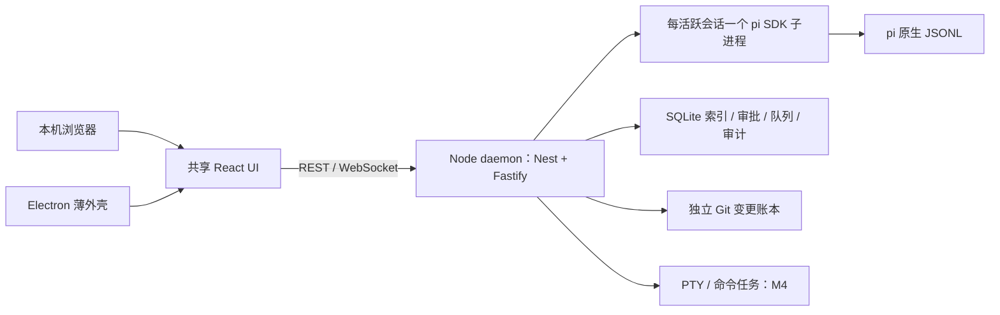

# Pi Workbench 实施方案

日期：2026-11-01（Asia/Shanghai）。状态：方案已确定，OPS-01 工程 / 离线 UI 基线已验收。关联 M1–M7；全量范围、依赖及进度仍以 `docs/product/backlog.json` 为准。

共同确认进展：用户已确认 Windows 桌面优先、保留本机网页入口、首个重点交付目标为 M3；服务采用 NestJS + Fastify，存储为 Drizzle + better-sqlite3 / pi JSONL，前端采用 React 组合，仓库采用 pnpm workspace。UI 已确认 Codex 式克制、中等密度、按需面板、跟随系统且明暗同等设计；屏幕“1080 100%”暂按 1920×1080 @100% 制稿。高保真已确认 A 日常对话 + B 展开审查组合，界面 / 消息 / 辅助字号为 14 / 15 / 12 px；[核心页面](../design/review.html)与[状态规格](../design/core-spec.md)继续细化。Node 24 仍为工程兼容基线，OPS-01 已固定并验证精确运行时与依赖版本。R9 已确认核心稿作为 M1 / M2 实现基线，先个人本地使用。记录见 [共同确认清单](../decisions/project-confirmation.md)，目录与边界见 [项目结构设计](project-structure.md)。

## 路线决定

独立实现 Pi Workbench，复用已经验证的 pi 1.4.0 SDK；采用 React Web UI、独立 Node daemon 和 Electron 薄外壳。PI-Desktop 用作规格、交互及测试参考，不直接 fork，也不整体移植它的 Rust 宿主或插件平台。

这符合当前目标：桌面与本机浏览器从第一版共用一个服务；保留 pi 原生历史；支持首次发送建会话、无项目会话、独立变更账本和后续 PTY。PI-Desktop 的现有桌面实现很有价值，但要适配这些规则，需要同时改动其宿主、持久化和客户端通路。独立路线避免在首版承担 Rust / TS 双工具链及上游架构迁移，代价是基础工作台需要自行实现与验收。

若目标只是立即使用现成桌面客户端，直接使用 PI-Desktop 有优势。本项目已经明确要建设双端、可追踪进度的自身产品，因此选择独立路线。后续若引用其源码，应单独记录固定提交、归属和 LGPL-3.0 要求；本次仅研究，没有复制产品源码。

## 技术栈与运行边界

| 层 | 确定采用 | 约束与验证时点 |
| --- | --- | --- |
| 工程 | TypeScript strict、pnpm workspace、ESM | TS 6.0.3；pnpm 12.16.1。精确锁文件与干净目录 frozen install 已验证 |
| 代码规范 | Oxlint + Oxfmt + Knip | 用户指定替换原 ESLint 方案；类型感知、import / package / Tailwind 排序、编辑器及门禁见 [代码规范](../development/tooling.md) |
| 运行时 | Node 24 LTS | 项目运行时固定并实测 24.22.2；pnpm 下载 / 选择该版本，系统 Node 26.13.0 不替换 |
| 前端 | React 19、Vite 8、Tailwind 4、shadcn/ui 基础组件 | 共享同一 SPA；不使用 Next.js / SSR；流式状态由自己的领域契约控制 |
| 状态 | 纯事件 reducer、Zustand 5、TanStack Query 5 | reducer 是运行状态唯一投影；Query 管列表 / 设置等请求缓存，不能另存一份可写运行状态 |
| 服务 | NestJS 12 + Fastify 5 适配器、REST + WebSocket、Zod 4 | Nest 模块管理服务 / 生命周期；daemon 为业务权威；契约与核心算法不依赖 Nest，双端不各自编排 agent |
| Agent | `@earendil-works/pi-coding-agent@1.4.0` 及配套 pi 包 | 每活跃会话一个 SDK 子进程；升级先重跑离线契约，付费证据需有单独预算 |
| 存储 | Drizzle + SQLite（better-sqlite3 13）+ pi JSONL + inflight 检查点 | Drizzle schema / 显式迁移由 daemon 管理；SQLite 单写入方，JSONL 由 SDK 写；原生模块按独立 Node ABI 构建 |
| 变更 | 独立 shadow Git 账本 | 延续 CORE-03 的原始字节、归属观察链、冲突预检和条件补偿，不操作用户 index / HEAD |
| 桌面 | Electron 45 薄壳、electron-builder 26 | main 只管窗口、系统集成、监护与更新；Renderer 无 Node 权限，preload 白名单 |
| 终端 | node-pty + xterm.js，M4 接入 | 留在 daemon；与 Electron ABI 分离；不因参考项目移除了 PTY 而删减需求 |
| 验证 | Vitest、Playwright、真实文件 / Git / SQLite、假内核 | 日常测试零付费；真实 Chromium / Electron 输入与恢复测试随阶段接入 |

2026-11-01 实际查询 npm 与 Node 发布元数据：Node 24.22.2 LTS、React 19.3.1、Vite 8.3.5、plugin-react 6.1.2、Electron 45.2.1、Fastify 5.12.7、better-sqlite3 13.0.3、Zod 4.6.7、Tailwind 4.3.3、Zustand 5.0.16、Query 5.105.0、pnpm 12.16.1。OPS-01 已完成精确锁定、干净安装、类型检查、构建、SQLite 原生迁移与 SDK 子进程冒烟；证据见 docs/validation/ops-01-acceptance.md。TypeScript 原方案 5.9.3 因 Vitest ESLint 插件要求 >=6 调整为 6.0.3。Electron 实际启动已验证，安装包 / 发布尚未实现。

Node 24 是成熟的受支持 LTS，当前 Node 26 也已进入 LTS；选择 24 是兼容与原生模块分发的工程基线，不表示 pi 或 NestJS 只能运行在 24，也不要求降级用户系统 Node。

OPS-01 已验证 Nest 启动 / 关闭、Fastify 只读 HTTP 与 Host / Origin 边界、Zod 契约、Drizzle 显式迁移、Node SQLite 原生模块、SDK 子进程和 Electron 开发壳。WS 鉴权 / 重放、真实会话权限、进程监护和 Electron 打包仍按 CORE-04 / 05、UX-05 与 OPS 后续条目验收。

桌面安装包携带独立 Node 24，`piw serve` 也使用相同服务入口；开发允许显式指定同一版本的 Node。普通用户无需安装系统 Node。不采用 `ELECTRON_RUN_AS_NODE`，避免 PTY / SQLite 的 Node 与 Electron ABI 分叉。M2 做桌面启动冒烟，M4 验证 PTY，M5 验证完整安装 / 升级 / 退出，发布体积以实际产物为准。

M0–M7 仅回环监听。同源 Web 资源由 daemon 提供；浏览器一次性配对、HttpOnly Cookie、Origin / Host 校验及 WebSocket 鉴权不能留到远程阶段再补。桌面连接同一 daemon，不新增另一套执行和审批 API。

## PI-Desktop spec 的采纳范围

| 规格领域 | 采纳到本项目 | 阶段与功能 ID |
| --- | --- | --- |
| 产品与架构 | UI / 特权服务 / agent 分离；有版本的边界契约 | M1 OPS-01、CORE-04 / 05；保留 Node 宿主和双端 |
| 协议与状态机 | 稳定消息 / 工具 / 轮次 ID；首个终态决定生效；旧轮次事件不结束新轮次 | M1 CORE-05、OPS-08；产品轮次仍按 D04 settled + snapshot |
| 存储与恢复 | 单写入方、启动栅栏、有界分页、流式检查点 | M1 CORE-06；复用 pi JSONL，不另造 Desktop 正文格式 |
| 会话与工作面板 | 每会话草稿、阅读锚点、工具展开和面板上下文；后台事件不抢焦点 | M2 SESSION-02、OBS-04；M4 UX-01 |
| 命名与搜索 | 本地标题回退、来源 / 版本 CAS；统一搜索入口可发现命令 | M2 SESSION-10 / 11 / 12；完整命令目录 M4 UX-02 |
| 工具与权限 | 最终参数裁决、取消唤醒等待、授权撤销、不可达不放行 | M2 SEC-01–04 / 09；执行入口延续 CORE-02 |
| 输入与附件 | IME、精确草稿恢复、长粘贴引用与内容分页 | M2 INPUT-01；M4 INPUT-03；附件暂存不提前创建会话 |
| 模型与上下文 | pi 模型目录优先；用户配置显式继承；截断标记、原结果保留和按需读取 | M4 MODEL、EXT、OBS；不复制自建上下文引擎或额外提供商 SDK |
| 安全 | Renderer 隔离、链接白名单、敏感字段脱敏、进程失败关闭 | M2 SEC-06 / 08、UX-05；真正 OS 沙箱 M5 SEC-05 单独验收 |
| 插件 | 清单、能力快照、启停、权限变化与兼容矩阵 | M4 基础适配，M6 EXT；不引入 `.piplug` 市场、签名平台或任意插件 UI 作为首版前提 |
| 交付与测试 | ADR / 规格 / 实现关联；离线 fixture；真实 UI 组合输入 / 导航 / 崩溃场景 | M1 OPS-08，M2 输入与双端，M5 发布 / 升级 |
| Worktree、多 Agent、自动化 | 真正并行写入隔离、任务身份、级联取消和预算 | M6 GIT，M7 MULTI / AUTO；不提前塞入 M2 |
| 远程、语音、图像、配置同步 | 保留候选，不作为本地版阻塞项 | M8 REMOTE / EXTRA，单独决定成本与授权 |

明确保留的差异：D15 首次发送才持久建会话；移除项目保留会话及文件；D07 独立账本保护用户已有脏改动；分叉不隐式恢复文件；PTY 仍交付；“计划”不能仅靠提示词限制写工具，也不复制参考产品 Plan + Auto 下允许 Bash 修改文件的语义。讨论 / 计划 / 执行的工具矩阵按 INPUT / SEC 条目细化，宿主策略才是执行边界。

## 关键实现规则

1. **单一正文来源。** SDK JSONL 保存已提交的真实历史。SQLite 维护索引、元数据、待送达请求、审批、队列和账本引用。搜索索引是可重建派生数据，以原消息 ID 回源；不得将搜索片段或 UI 截断结果写回历史或模型上下文。跨端创建请求持久去重，恢复不根据正文相等猜测是否已发送。
2. **流式恢复。** daemon 每 1.5 秒以内的目标间隔原子替换独立 inflight 文件，并在最终事件到达时刷新。用 sessionId / turnId / messageId / runtimeEpoch / seq 绑定，旧写入不得复活已完成消息。恢复仅展示“已中断的部分回复”，最终 SDK 消息存在时去重取代；不伪造 SDK JSONL 记录，不自动重放工具。间隔是初始策略，磁盘故障和硬杀损失范围必须实测。
3. **有界展示。** 初始历史每页最多 100 条，单条展示载荷初始 64 KiB；超限给出展开 / 分页入口，原文完整保留。UI 按 sessionId 保存滚动消息锚点与偏移、草稿及工具展开；最多保留 3 个会话视图，其余卸载后从锚点恢复。视图缓存与 SDK 进程池分别管理。
4. **增量不丢字。** 一帧内累计所有 `text_delta`，可合并渲染；不得只保留最后一个 delta。审批、错误、取消和最终消息立即冲刷。序号缺口则重新同步，最终消息覆盖临时投影并去重，不能继续盲目追加。
5. **工作面板归会话。** 文件、Diff、计划及产物均带会话 / 工作区身份。后台任务更新其会话标识，不自动打开面板或切换正在阅读的文件。终端归实际工作区；附加输出需用户明确操作。
6. **本地审批无倒计时。** 交互式本地工具审批持续等待允许 / 拒绝 / 取消。换会话、关闭审批展示、短暂断线不裁决，也不执行；turn 取消、内核 / 服务退出、参数或策略代际失效立即拒绝旧请求并唤醒等待。首个有效决定生效；待审批占用的资源可见且可取消，不被 LRU 回收。执行超时、连接健康检查和将来的无人值守审批是独立规则，无人值守缺少预授权时拒绝。本决定取代 Q05 原“10 分钟自动拒绝”候选。
7. **零额外命名调用。** 默认只按首条消息生成本地脱敏标题，最多 40 个 Unicode 字符。可选模型润色默认关闭，显式启用后使用已有提供商 / 模型、单次请求、10 秒超时、无工具；人工标题通过来源和版本保护。此处 10 秒是可选命名期限，不是审批期限。
8. **资源与费用。** 初始活跃内核最多 3、同时模型任务默认 1、终端最多 6；超限 FIFO 排队，可取消，运行 / 审批内核不自动回收。日常开发离线；R6 已授权必要真实验收每里程碑最多新增 2 次底层请求、单次输出最多 512 token、失败不自动重试。不另加标题、摘要、评审 Agent；失败 / 中止 / 压缩 / 工具后续回合均计数，先持久预占。OPS-01 验证原子守卫与 SDK 输出限制，不能可靠约束的路径先用离线样本。价格未知显示未知，不承诺金额硬上限；产品正常使用的通用预算仍属 M7。[预算政策](../validation/live-validation-policy.md)与[记录](../validation/live-validation-budget.json)区分已验证的持久预占算法和仍禁用的真实传输；SDK 隐式路径与提供商输出约束开放前单独验证；旧 4 次独立保留，本次新增 0 次。
9. **输入暂存。** 新会话使用独立 draftId；长粘贴 / 附件存入草稿暂存区，首次发送成功才绑定 sessionId。长粘贴引用保留精确字节、预览及撤销；失败保留原草稿，清理先判引用与宽限期。引用本身不保证节省 token；是否发送全文须在上下文预览说明。
10. **信任边界。** 执行守卫与进程隔离分别验收。原生 pi 扩展是可执行本地代码，其直接 Node API 不受工具守卫完全约束；不将 Rust、utilityProcess 或插件权限声明等同于 OS 沙箱。未验证能力默认禁用；M5 给出实际平台能力矩阵。

R6 默认权限：仅经验证的受限只读自动执行，写文件与命令先审批；普通命令不因声明只读而放行。显式会话授权绑定工具 / 最终参数 / 路径 / 目录边界，L3 始终单次确认。权限配置的进一步变化按 SEC-03 / 04 验收。

R6 生命周期：Electron × 默认收到托盘，保持任务 / 审批；自启默认关闭。菜单退出应用先保存并取消待审批 / 排队，停止受管 SDK、命令 / PTY 和 daemon，确认停止才完成退出。退出失败显示未停止对象与恢复方式；不误停独立 serve 或其他 CLI。浏览器关闭只断开查看。重启恢复记录、草稿和中断状态，不自动重放队列、副作用或旧授权。UX-05 验收真实窗口 / 托盘 / 服务行为；当前设计稿只提供说明预览。

## UI 何时设计、何时开发

现在就确定 UI 基线，不等到 M4。沿用现有 PRD 的中性灰、系统中文字体、左侧项目 / 会话、中间对话、右侧按需面板、底部终端。侧栏 244 px 为初始值；窄窗折叠为抽屉，输入、停止和待审批始终可达。状态用文字和图标表达，焦点可见，减少动效；面板上下文与执行上下文分别标注。

| 时间 | 必须产出 | 验收归属 |
| --- | --- | --- |
| M1 / OPS-01 同步 | 设计 tokens、基础组件和 UI 壳；新会话 / 运行 / 审批 / 错误 / 断线 / 恢复的可评审状态，使用假数据 | 只记录设计与工程基线，不能提前验收 SESSION / OBS / SEC |
| M2 | 接真实服务的创建、流式、中止、审批、切换、改名、搜索，以及浏览器 + Electron 入口 | SESSION、INPUT-01、OBS、SEC、UX-05 的各项验收 |
| M3 | 真实变更列表、Diff、接受、回滚、冲突与恢复 | CHANGE 及相关 WS / SEC |
| M4 | 完整可恢复面板、命令搜索、文件引用、PTY、设置与用量 | UX-01 / 02、INPUT、EXEC、MODEL |
| M5–M7 | 分发 / 沙箱 / 平台硬化，再增 Git、扩展、多 Agent、自动化 | 保留既有里程碑及依赖 |

不另起一套视觉重设计。UI/UX Pro Max 两次“阅读位置 / Scroll Restoration”定向查询返回的是平滑锚点和水平溢出建议，不足以证明会话恢复策略；未采用这些结果作为会话方案依据。具体恢复规则来自 PI-Desktop 的 ADR / 源码与本产品流程，焦点、键盘和响应布局使用现有设计及通用可用性原则。

## 接下来按这个顺序实施

| 工作包 | 关联功能 | 可评审结果与门禁 |
| --- | --- | --- |
| 1. 工程与契约基线 | OPS-01 | pnpm workspace、Node 24 固定、shared Zod / reducer、web / daemon 入口、SQLite 冒烟；M1 基础 UI 壳与状态清单；干净目录安装 / 类型 / 构建通过 |
| 2. 会话子进程 | CORE-04 | 单 SDK 子进程 ready / prompt / abort / dispose、守卫握手、异常隔离；先 fake kernel，再真实 SDK 离线，无付费请求 |
| 3. 契约门禁 | OPS-08 | M1 基线已交付：14 份固定录制、重复 / 缺口 / 迟到终态 / IPC 断开 / 审批取消、实际 UI 故障回归；随各阶段继续补齐真实产品验收 |
| 4. 状态与恢复 | CORE-05 / 06 | CORE-05 已验收：真实 SDK 本地事件、REST 快照、WS 双客户端重放 / 重同步；CORE-06 已验收 pi JSONL 索引、inflight / 队列 / 审批恢复记录 |
| 5. 有界资源 | CORE-07 | 3 内核 / 1 模型任务 / 6 终端配置、FIFO 与取消、不可回收待审批，完成 M1 阶段门 |
| 6. 可日常试用的对话 | M2 现有功能 | 真实新会话到中止、审批、查找、改名及跨端同步；不以静态壳代替产品完成 |

工作包是功能的实施细分，不新增完成率分母，不承诺未经估算的日期。当前为 **7 / 133 已验收**（CORE-01–06、OPS-01，M1 阶段门尚未完成），146 个全量功能 ID、M0–M8 范围及负责人保持不变。前两个工作包及 CORE-05 / 06 已验收，OPS-08 的 M1 契约基线已交付、整体继续进行中；下一项产品工作为 CORE-07。Q01 / Q02 已有 M0 证据；选定的后续默认值只表示方案决定，不表示产品实现通过。

### CORE-04 已交付边界

daemon 的 `KernelService` 是唯一会话进程注册表，同时请求同一会话复用同一代际；cwd 经 realpath 固定，显式销毁后才可重建新 epoch。`SessionKernel` 管理启动 / ready / prompt / stopping / stopped / dispose，Zod 校验 IPC 版本、sessionId、turnId、epoch 与进程序号；核对实际 PID / cwd / SDK cwd / sessionFile。启动守卫不匹配、非法或旧轮次消息、IPC 丢失及进程崩溃均使该代际失效，不自动重启或重发。销毁等待实际进程退出；中止 / 销毁无响应时有界强杀，daemon 退出等待所有子进程，宿主硬退出后 SDK 子进程也清理正在运行的流。

当前执行能力固定为 **deny-all**：工具 / MCP / 扩展 / 技能均禁用，SDK 创建后及每轮前检查可执行工具为空。模型运行时使用独立空认证与本机 SSE 夹具，传输只允许该夹具 URL，禁止重定向与自动重试；不读取现有 pi 认证或改变配置。`real-sdk/local-fixture` 表示真实 SDK 配合本地模拟模型；`synthetic-ipc-fixture` 仅用于握手 / 断线 / 乱序 / 超时等故障注入。允许受限读取、生产审批的最终参数包装和真实模型预算守卫仍按后续 SEC / MODEL 功能验收。

浏览器与 Electron 继续连接同一 daemon；`GET /api/kernels` 仅只读诊断，两个观察者读取同一注册表，断开查看不销毁进程。UI 仍为 fake kernel 样本，没有 prompt / 审批写 API。这里的本地运行态与 SDK JSONL 不等于 CORE-05 的客户端重放或 CORE-06 的索引 / inflight 恢复；资源配额仍属 CORE-07。

验证：本轮新增 24 项 adapter / daemon 测试，完整 Vitest 36 项和浏览器 / Electron E2E 6 项通过；真实 SDK 本地流式、错误、未知工具拒绝、中止、运行中销毁、真实子进程硬杀隔离与宿主丢失清理均实际运行。`pnpm fix`、`pnpm run ci`、`pnpm verify:clean` 退出 0，干净目录 frozen 安装 / 构建 / 测试 / 冒烟 / 启停与锁文件 SHA-256 一致，新增真实提供商请求为 0。实现与可复验场景见 `packages/agent-adapter/src/kernel*.ts`、`sdk-child.ts`、`sdk-runtime.ts` 和 `apps/daemon/test/kernels.test.ts`；原始结果保留于 [CI 输出](../validation/core-04-evidence/ci.log)、[干净目录结果](../validation/core-04-evidence/clean-workspace.json)、[干净目录命令输出](../validation/core-04-evidence/clean-commands.json)。历史 M0 / OPS-01 证据不改写。

### OPS-08 已交付边界与后续绑定

M1 契约基线通过。测试只读重放 14 份 CORE-01 / 02 历史录制，固定原始字节 SHA-256、来源、事件与可见结果；包含原提供商的正常 / 压缩 / 中止证据，不重新调用。桥接事件及缺口注入为合成输入，不冒充生产 CORE-05 协议。共享纯投影已修正跨会话 / 代际误选、开始事件掩盖缺口及迟到事件改写终态；完整快照通过 Zod 验证后恢复，当前握手身份与请求版本仍由后续传输实现负责。

既有 SDK 子进程用例增加协议版本、重复 / 缺号、错误轮次 / 结果与旧终态注入；网页使用真实组件回归重复 / 超长 Unicode、缺口暂停与显式恢复、迟到响应、格式不兼容、未知命令文本和渲染异常。异常时保留草稿，使用既有 shadcn Alert / Button；仅离线展示恢复，不自动执行 / 重试 SDK。渲染故障场景故意抛出的 React 日志保留，错误边界和键盘返回实际验证。

`pnpm test:contracts` 提供定向入口；完整 test / CI 已包含同一批测试。OPS-08 首次基线的完整 CI 为 **85 项 Vitest + 12 项浏览器 / Electron E2E**，`pnpm fix`、`pnpm run ci`、`pnpm verify:clean` 退出 0，干净目录安装 / 构建 / 启停通过且锁文件一致，新增真实提供商请求 0。验收范围、逐阶段矩阵与截图见[工具规范](../development/tooling.md#ops-08-契约回归门禁)；原始 [CI](../validation/ops-08-evidence/ci.log)、[干净目录结果](../validation/ops-08-evidence/clean-workspace.json)与[命令输出](../validation/ops-08-evidence/clean-commands.json)独立归档。

OPS-08 第一条验收通过，第二条仍未通过，整体保持 `in_progress`。CORE-05 的双客户端握手 / 重放已绑定同一门禁，CORE-06 恢复也已绑定，接着补 CORE-07 资源门禁；M2 的真实 IME / 草稿 / 切换 / 改名 / 审批 / 双端重连、M3 回滚及后续平台验收随产品实现纳入。离线 UI 及程序合成 IME 用例不能替代这些真实产品验收，不将 OPS-08 整体提前记为已验收。

### CORE-05 已交付边界

daemon 的 `EventService` 保存每会话的完整内存观察快照和有界重放日志，`KernelService.prompt / abort` 是当前内部应用入口，按同一 SDK 运行时发布开始、全部文本增量、工具观察及终态。工具由 SDK 的 `tool_execution_start / end` 映射，未知工具的拒绝有真实 SDK + 本地模型夹具证据；工具执行仍禁用。审批帧的投影与即时发送已用合成观察测试，生产审批服务仍属 M2。所有下行帧立即发送，不用节流丢弃最后一个 delta；`completed` 表示当前 deny-all SDK 生命周期结束，不代表 M3 变更快照或审查完成。

| 接口 | 当前行为 |
| --- | --- |
| `GET /api/protocol` | `hello` 返回独立的协议版本与实际能力列表、daemonId；明确 `mutations: false`、真实提供商关闭 |
| `GET /api/sessions/:sessionId/snapshot` | 完整内存快照及同一边界的 seq；未知运行时 404，`Cache-Control: no-store`，不读写截断历史 |
| `WS /api/events` | 先 hello，再接收且仅接收一条带版本 / 必需能力 / daemonId / sessionId / epoch / since 的 subscribe；重放后发 caught-up 并持续推送 |
| `http://127.0.0.1:5173/?observe=<sessionId>` | 实际 React 只读观察页，复用 shadcn Alert / Button / Bubble；系统明暗、窄窗与键盘断开 / 重连；普通入口继续保留离线工作台 |

身份与顺序细化原架构草案的全局 seq：**daemonId** 每个服务实例唯一，**epoch** 每个内核代际唯一，**seq 在每个 sessionId + epoch 内连续递增**，事件 ID 固定为 `epoch:seq`。这样订阅单会话不会把其他会话的事件误判为缺口。turnId 不复用，当前聚合回复 messageId 为 `turnId:assistant`，工具以所属轮次内的 SDK toolCallId 去重，更新保留首次出现顺序。跨身份 / 旧代际回调被拒绝，重复与迟到终态不覆盖当前轮次。

快照捕获与游标在同一同步边界，重放到实时监听的交接不经过 await。默认重放保留最近 **1024 条 / 2 MiB**，任一超限淘汰最旧记录；仅日志淘汰，不截断完整快照或写回 SDK JSONL。游标过旧 / 超前、代际或服务不匹配均返回 `resync-required`。客户端遇到序号缺口停止增量拼接，校验并替换完整快照，再从新游标订阅；请求代际与 AbortController 拦住迟到快照，服务 / 内核重建不混入旧内容。

连接关闭只停止观察，任务继续；自动重连按 1 / 2 / 4 秒递增到最多 30 秒，只发送游标，不重发 prompt、审批或工具。HTTP 等待最多 5 秒；WS 在 10 秒内要求 subscribe，15 秒 ping / 下一周期无 pong 终止；入站订阅帧上限 16 KiB，出站积压超过 2 MiB 断开慢观察者。继承已有 Host / Origin 校验，WS 还拒绝缺失 Origin；这是当前只读通道边界，**不等于 SEC-08 配对、Cookie 身份或写权限服务已实现**。不兼容时保留内容，提示匹配版本 / 重启后再同步，变更入口保持禁用。

验证：新增 5 项共享契约、4 项服务 / 原生 TCP WebSocket 测试、4 项浏览器实际组件测试；完整 **94 项 Vitest / 16 项浏览器与 Electron E2E** 通过。两条 TCP 观察连接和两个浏览器客户端验证真实 SDK 本地流式、中止、未知工具拒绝、错误与补发；缓冲 / 丢帧 / 迟到快照 / 代际替换 / 版本能力异常为明确标注的合成观察或网络故障。浏览器测试仅将 REST 代理和原生 WS URL 指到隔离 daemon，不替换客户端 reducer 或制造正常 SDK 帧。`pnpm fix`、`pnpm run ci`、`pnpm verify:clean` 退出 0；全新目录安装 / 检查 / 构建 / 测试 / SDK 冒烟 / 启停通过，锁文件 SHA-256 一致，新增真实提供商请求 0，预算账本与历史证据未改。

实现位于 `packages/shared/src/runtime-contracts.ts`、`apps/daemon/src/modules/events`、`modules/kernels/kernel.service.ts`、`apps/web/src/services/runtime-client.ts` 与 `features/conversation/runtime-observer.tsx`；定向入口已并入 `pnpm test:contracts`。原始 [CI](../validation/core-05-evidence/ci.log)、[干净目录结果](../validation/core-05-evidence/clean-workspace.json)、[命令输出](../validation/core-05-evidence/clean-commands.json)及 [双端输出](../validation/core-05-evidence/runtime-two-clients.png)、[深色窄窗](../validation/core-05-evidence/runtime-dark-390.png)、[重同步](../validation/core-05-evidence/runtime-resync.png)、[不兼容提示](../validation/core-05-evidence/runtime-incompatible.png)独立归档。CORE-05 两条验收通过；内存快照不等于 CORE-06 的持久化 / inflight 崩溃恢复，资源配额留待 CORE-07，真实发送 / 审批、历史分页和正式会话 UI 随后续功能验收。

### CORE-06 已交付边界

SessionStore 是 daemon 唯一持久索引与恢复记录服务。显式 Drizzle 迁移新增 sessions、session_runtimes、session_turns、session_queue、session_approvals、session_changes；SQLite 使用 WAL、synchronous FULL 与外键。数据根的 PID / token 租约拒绝同一目录的第二个活跃 daemon，死进程租约可替换，损坏 / 无法确认的租约保留并拒绝启动。退出由 KernelService 等待 SDK 终态及实际进程退出，然后关闭事件观察、冲刷检查点、关闭 SQLite 与释放租约，避免 Nest 并发销毁使终态丢失。

正文仍只由 SDK 写入原生 v3 JSONL。每轮 prompt 前通过 SDK SessionManager.appendCustomEntry 写入 pi-workbench.turn.v1 元数据，绑定 sessionId / epoch / turnId / messageId；它不参与模型上下文。读取器不调用会迁移 / 重写的 SessionManager.open，按原生 id / parentId 读取当前分支，识别系统元数据，校验 UTF-8、版本与身份。损坏 / 重复 / 缺父记录、未完整末行、缺失源和索引 / 检查点损坏均保留原件并报告，受损会话阻止新任务；其他会话可继续读取。每条诊断可导出对应原始字节，缺失文件没有可导出的字节。完整正文与展示截断结果不写回 JSONL / 模型上下文。

| 入口 | 当前行为 |
| --- | --- |
| GET /api/sessions | 读取受管会话索引；不创建 / 接管旧 CLI 会话，不启动内核 |
| GET /api/sessions/:sessionId/history | 默认最新 100 条 / 页；单条文本预览最多 64 KiB UTF-8，稳定消息 ID 锚定更早页面；失效游标明确要求刷新 |
| GET /api/sessions/:sessionId/messages/:messageId/content | 显式读取完整原文，返回安全 text/plain；不接受客户端文件路径 |
| GET /api/sessions/:sessionId/diagnostics/:diagnosticId/raw | 下载单条损坏记录的精确二进制原件，不编码转换或自动修复 |
| http://127.0.0.1:5173/?history=<sessionId> | 实际 React 只读历史页，复用 shadcn MessageScroller / Message / Bubble、Alert、Badge、Button；分页、全文展开、键盘刷新与带错误反馈的二进制下载 |

独立检查点路径为数据根 inflight/<sessionId>/<epoch>-<turnId>.json，仅包含当前未落入 SDK 的观察投影；开始在任务发送前持久化，文本以 **1.5 秒目标间隔** 合并，工具 / 审批 / 停止 / 最终事件立即冲刷。写临时文件、fsync 后 rename 原子替换，不先删除旧文件；真实文件系统写入失败时保留旧检查点、提供诊断并阻止新任务。目标间隔受到事件循环和磁盘影响，不是硬实时或断电损失保证。

恢复按 sessionId / epoch / turnId / messageId / seq 校验，迟到旧 seq 不覆盖新检查点。SDK 终态原文存在时替代旧部分回复；不存在时仅展示“已中断的部分回复”，未确认送达的输入单独标记，均不伪造 SDK 记录。CORE-05 恢复最新轮次观察、换用新 daemonId 并将 seq 归零，旧游标重新同步；更早正文走分页读取。重启不创建 SDK 进程、不自动重发队列 / 工具或恢复旧授权：queued 变 held，pending 审批变 invalidated，已有 allowed / denied 只保留审计且 executable=false，变更引用仅只读保存。

边界：当前是受管本地 SDK 历史与恢复底座，普通工作台仍使用离线样本，没有真实发送 / 续聊 / 审批写 API。队列、审批和变更引用用明确标注 synthetic-fixture 的持久记录验证，不代表其 M2 / M3 业务服务或可回滚快照已实现。SDK 在新代际显式创建的会话不会自动把展示历史当成模型上下文；CORE-07 冷恢复、SESSION-06 接管 / 续聊仍须分别实现。现有 CLI 历史发现属 M2，数据目录迁移 / 备份和数据库页损坏恢复属 OPS-04 / 05。分页限制响应与展示载荷；当前仍扫描 JSONL 校验分支，不承诺超大历史 IO 或性能指标。

验收：新增 **12 项 Vitest + 3 项浏览器流程**，完整 **106 项单元 / 集成、19 项浏览器与 Electron E2E**、SDK 冒烟通过；pnpm fix、pnpm run ci、pnpm verify:clean 退出 0。真实 SDK + 本地 HTTP 模型夹具实际完成正常 / 中止 / 错误、相同正文不同轮次，以及 SDK / daemon 同 tick SIGKILL 后的持久恢复；正常读历史和恢复均不修改 SDK 原件。分支 / 未来版本 / 损坏 / 分页 / 长 Unicode、旧检查点身份 / seq / 终态去重及工作台记录是明确标注的合成样本；检查点写失败使用真实文件系统阻断。浏览器用实际组件与隔离 daemon 验证分页、全文、部分回复、诊断原始下载、明暗 / 390px 与键盘刷新，不替换存储或生成正常 SDK 帧。全新目录 frozen 安装、检查、构建、106 项测试、冒烟和服务启停通过，锁文件 SHA-256 一致，真实提供商新增请求 0，真实预算与历史证据未改。

实现为 packages/shared/src/history-contracts.ts、packages/agent-adapter/src/native-history.ts / sdk-child.ts、apps/daemon/src/modules/sessions 及数据库迁移、events / kernels / bootstrap 接线、apps/web/src/features/conversation/session-history.tsx；原生读取、存储和真实硬杀已加入 pnpm test:contracts。原始 [CI](../validation/core-06-evidence/ci.log)、[干净目录结果](../validation/core-06-evidence/clean-workspace.json)、[命令输出](../validation/core-06-evidence/clean-commands.json)，以及复核的 [原生历史](../validation/core-06-evidence/history-native.png)、[深色窄窗](../validation/core-06-evidence/history-dark-390.png)、[中断恢复](../validation/core-06-evidence/history-interrupted.png)、[诊断与导出](../validation/core-06-evidence/history-diagnostic.png)独立保留。CORE-06 两条验收通过；下一项 CORE-07，M1 阶段门仍未完成。

## 评估证据

- [PI-Desktop 完整 spec 索引](https://pi-docs.aiuo.net/zh-CN/spec/README)，2026-11-01 实际读取；重点读取架构、技术栈、状态机、权限与安全，对长协议 / 数据 / UI / E2E 文件做针对性抽查。没有宣称逐页逐项测试过全部规格。
- [固定仓库提交](https://github.com/vastsa/PI-Desktop/tree/a21527e5c9ca272bb5e6714038c2d22a61fef68e)，含英文 ADR 和关键源码。在线技术栈仍写 pi 0.86.1，而该提交 agent-runtime 实际依赖 1.4.0；权限页面仍写 120 秒，ADR 0310 已改为本地无倒计时。因此以具体 ADR / 源码交叉核对，不能把 spec 汇总页面当作最新实现证明。
- [原始评估与源码定位](../decisions/pi-desktop-review.md)、[在线抽查清单](../decisions/pi-desktop-spec-audit.json)。未安装或运行 PI-Desktop，未验收它的功能。
- 本项目运行边界来自 [M0 综合验收](../validation/m0-acceptance.md)，生产实现仍逐项验收。

## R7 / R8 已确认默认值

数据默认当前用户 `%LOCALAPPDATA%\PiWorkbench`，M1 统一数据根；M5 支持设置中受控迁移，一致性复制校验成功才切换，失败保留原数据，不搬用户项目或 pi 模型配置。首版 M2 发现并只读查看旧 pi 历史；后续受保护续聊在 SESSION-06 验证锁 / CLI 并发与版本冲突。备份仅升级前自动，其余手动，可选其他磁盘，不含模型密钥；不启用每日 / 7 份轮转。详见 [数据生命周期规格](data-lifecycle.md)。

M4 默认 Shell 优先发现可用 PowerShell 7，缺失提示并可换 Windows PowerShell；外部编辑器优先 VS Code，均允许修改。M5 先当前用户安装包，尽量免管理员，便携版后续；更新手动检查 / 确认，运行中不自动重启。仅后台通知需要审批 / 失败 / 完成，通用状态隐藏标题、正文与路径，可关闭或仅待决定，系统禁用时保留应用内待办。当前只是设计确认；实际发现、迁移、打包和通知均按 backlog 验收。
